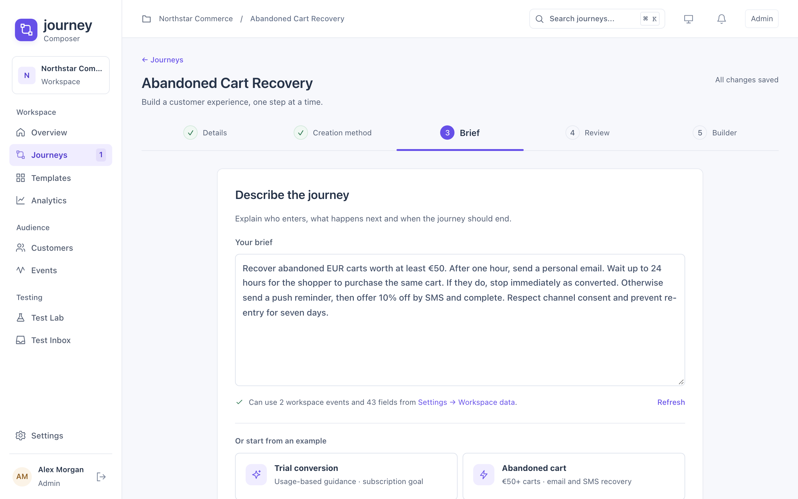
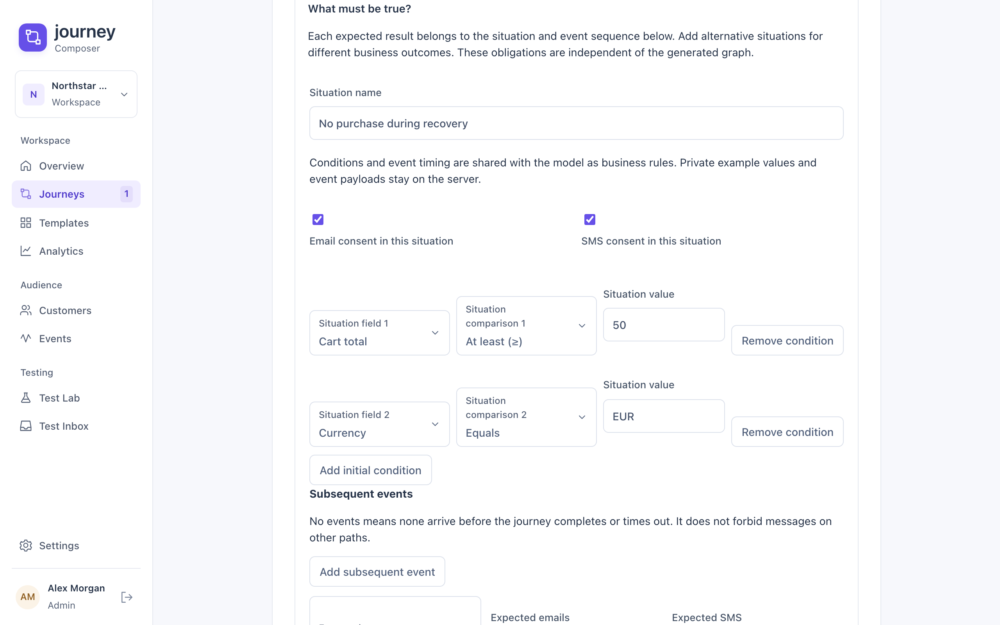
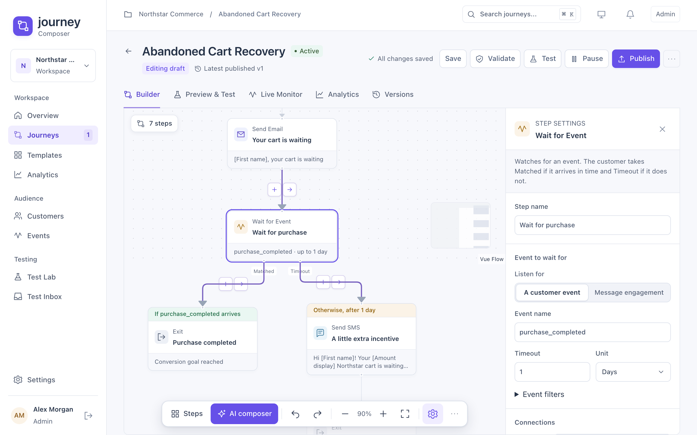
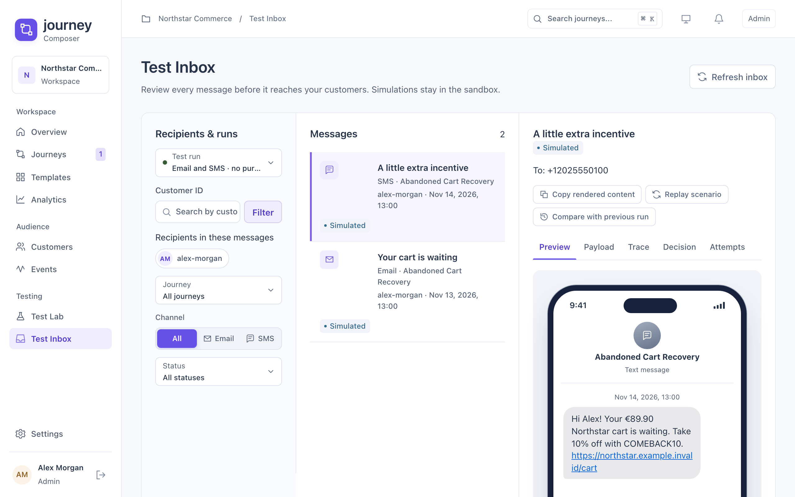
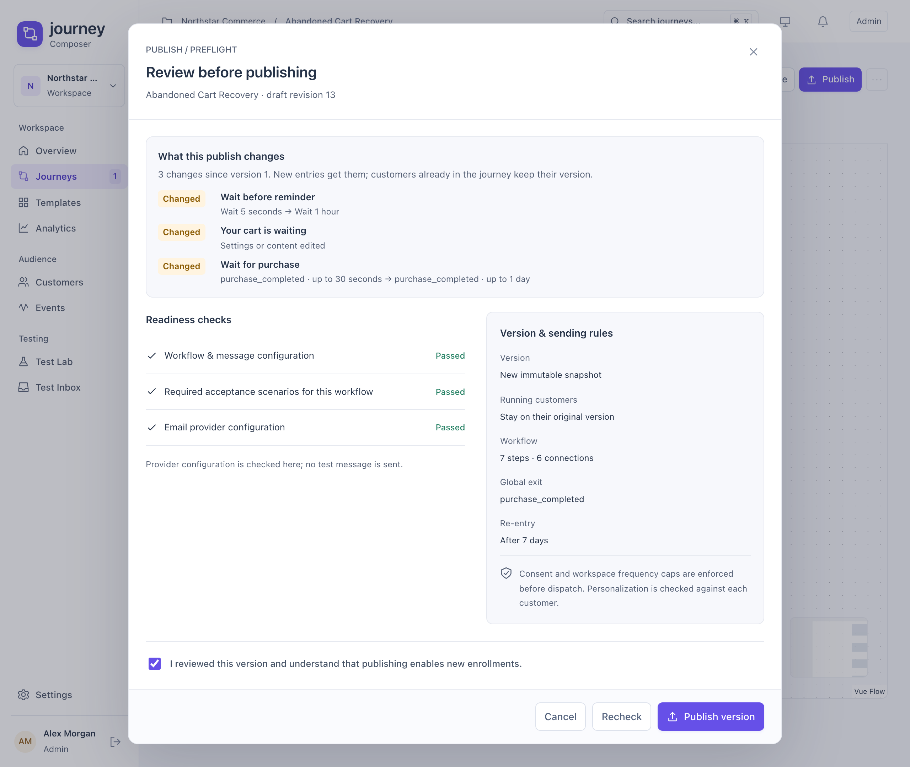
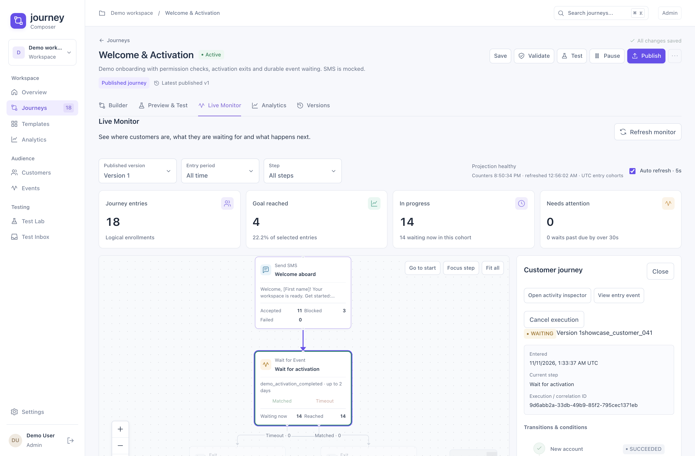
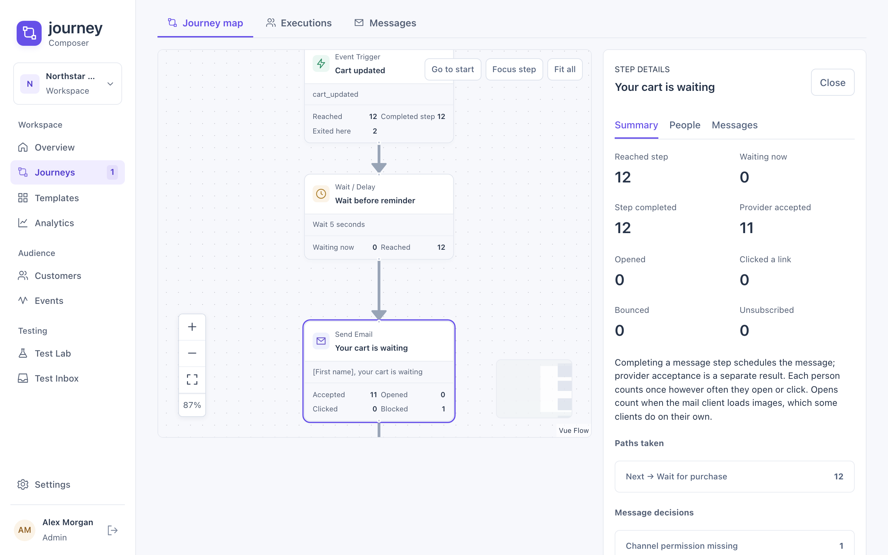
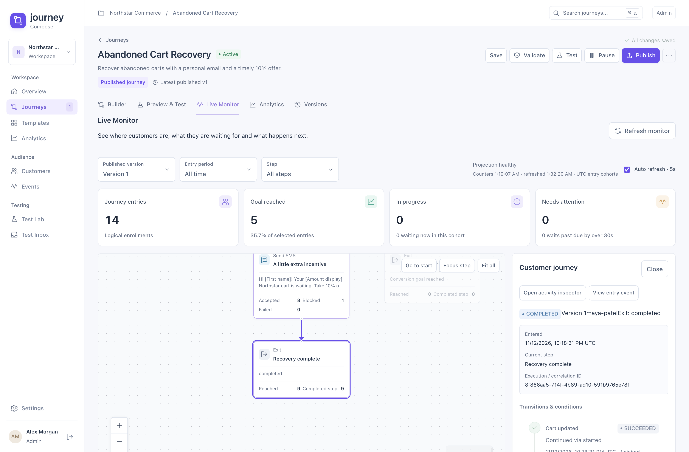
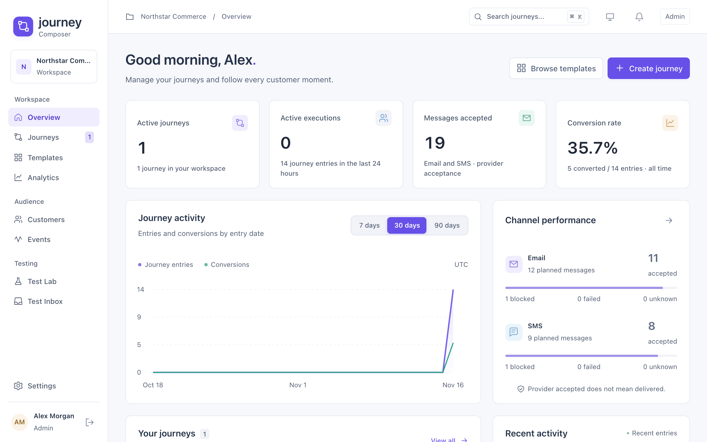
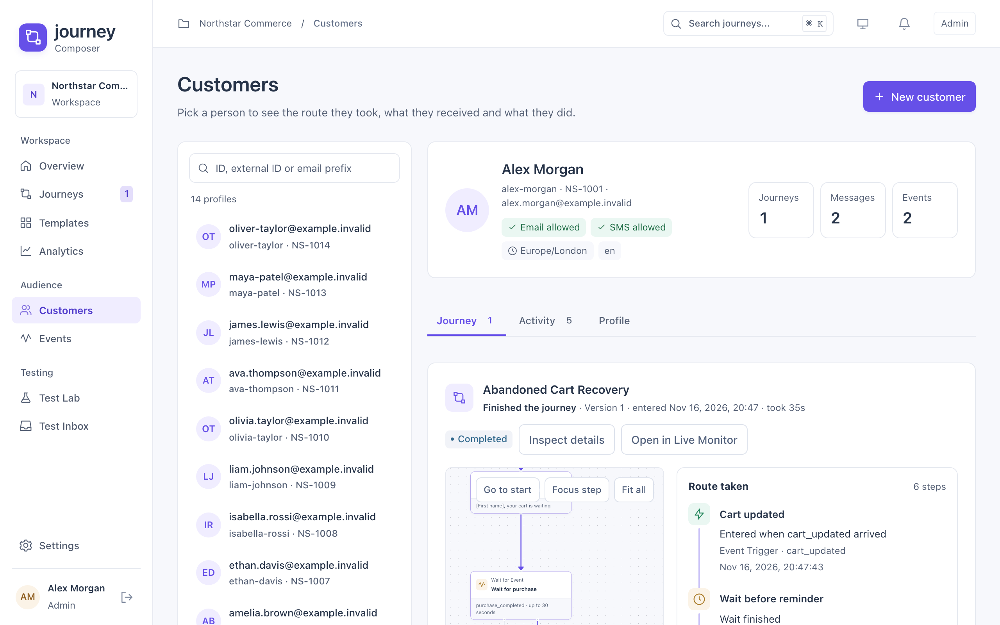

# Customer Journey Composer

[](https://github.com/negativexq/customer-journey-composer/actions/workflows/ci.yml)

Turns a plain-language brief into a customer journey on a visual canvas: an entry event, waits, conditions, branches, email, SMS and push steps, and a goal that ends the journey. Claude or OpenAI proposes the journey, a person reviews and applies it, and a Go runtime on PostgreSQL executes the published version step by step for each customer. A Test Lab runs days of a journey in seconds on a virtual clock, and the live monitor follows every customer through it.

The AI only proposes. It cannot save, publish or send anything: a person applies its draft, a person publishes it, and the runtime then runs that fixed version without a model. Email goes to a local Mailpit inbox and SMS to a mock provider, so nothing leaves your machine.

To run it yourself, follow [Install from scratch](#install-from-scratch). It needs Docker and Node.js, and no API key.

Reviewing the code? [Under the hood](#under-the-hood) maps each piece of engineering to where it is explained and to what checks it. The [implementation tracker](docs/IMPLEMENTATION.md) records every change with the checks that were actually run.

## Under the hood

| Area               | What it does                                                                                                                                                                                                                                                                                                                      | Explained and checked in                                                                                                                  |
| ------------------ | --------------------------------------------------------------------------------------------------------------------------------------------------------------------------------------------------------------------------------------------------------------------------------------------------------------------------------- | ----------------------------------------------------------------------------------------------------------------------------------------- |
| The model's output | A versioned JSON schema shapes the answer. The backend then checks the graph, the message syntax and a behavior contract the person confirmed before the call, and compares every link, code and number in the messages with the brief. Invalid output goes back once with the reasons, and is never shown as something to apply. | [AI composer contracts](docs/AI.md), [behavior contract](docs/BEHAVIOR-CONTRACT-V2.md), [live validation history](docs/reports/README.md) |
| Human approval     | A proposal shows what it adds, removes and changes, with each changed setting before and after. Warnings need an acknowledgement, and an edit made while a proposal is open blocks applying it. Publishing is a separate Admin action with its own review.                                                                        | [Human approval](docs/AI.md#human-approval), [`tests/e2e/ai.spec.ts`](tests/e2e/ai.spec.ts)                                               |
| Durable execution  | PostgreSQL is the source of truth. Jobs are claimed with row locks and leases, fencing tokens stop a worker that lost its lease, and executions resume after a worker restart. There is no Redis.                                                                                                                                 | [Architecture](docs/ARCHITECTURE.md), `make test-recovery`                                                                                |
| Idempotent actions | Events are deduplicated, every logical action has a unique identity, and a transactional outbox carries sends, so a retry never sends twice from this side. An outcome the provider leaves unclear stays unclear instead of being reported as delivered.                                                                          | [Architecture](docs/ARCHITECTURE.md#implemented-domain-boundaries), [entry correlation](docs/ENTRY-CORRELATION.md)                        |
| Immutable versions | A published version cannot change. Customers already in a journey stay on the version they entered while a new draft is edited and published.                                                                                                                                                                                     | [Versions test](tests/e2e/versions.spec.ts)                                                                                               |
| Sending rules      | Consent, frequency caps, the customer's lifecycle state and the journey's global exit are checked when a message is about to go, not when the journey was written.                                                                                                                                                                | [Security and operations policy](docs/SECURITY.md#lifecycle-and-provider-safety)                                                          |
| Provider failures  | Backoff with jitter, a pause on 429, a credential lock on 401, a circuit breaker per workspace and channel, and a rate window, all held in PostgreSQL rows so every worker sees them at once.                                                                                                                                     | [Delivery resilience](docs/DELIVERY-RESILIENCE.md)                                                                                        |
| Test Lab           | Runs the real journey logic against a sandbox on a virtual clock, with injected events and provider failures, and checks expected outcomes. A sandbox never touches production customers, queues or metrics. A journey whose required scenarios fail cannot be published.                                                         | [Behavior checks](docs/BEHAVIOR-CHECKS.md), [`tests/e2e/test-lab.spec.ts`](tests/e2e/test-lab.spec.ts)                                    |
| Workspaces         | Sessions and API keys are scoped to a workspace, with Admin, Editor and Viewer roles enforced by the API and an audit record of changes.                                                                                                                                                                                          | [Security and operations policy](docs/SECURITY.md)                                                                                        |
| Performance        | A measured 10,000-customer workload, before and after each optimization, with the raw results and what did not improve.                                                                                                                                                                                                           | [Performance](docs/PERFORMANCE.md), [operational follow-up](docs/OPERATIONS-PERFORMANCE.md)                                               |
| Observability      | JSON logs with the trace ID, OpenTelemetry traces, Prometheus metrics and alert rules, and a local Grafana and Tempo stack.                                                                                                                                                                                                       | [Telemetry](#telemetry)                                                                                                                   |

## Product tour

The screenshots come from the running application with the Northstar Commerce demo: one Abandoned Cart Recovery journey and 14 fictional customers. Counts are read from stored records. The creation screens replay a recorded generation of the same journey, so they can be reproduced without an API key; [docs/SHOWCASE.md](docs/SHOWCASE.md) explains how each picture is made. Select one to open it at full size.

### 1. Describe the journey

Choose **New journey → Create with AI** and write what should happen in everyday language, or start from an example. The page lists the events and customer fields the workspace has, so the brief can use their names.



Before the model is called, you confirm what the journey must do in each situation: how many emails and SMS, and how it ends. These expectations are checked against every proposal.



### 2. Review the proposal

The proposal is drawn as a diagram, with each alternative path. Request a change in your own words, or approve it to open an editable draft. Approving does not publish.


[Business expectations and approval](docs/images/creation/review.png) · [Generation progress](docs/images/creation/generating.png) · [Creation method](docs/images/creation/method.png)

### 3. Edit it on the canvas

Every step is editable: triggers, waits for a time or an event, conditions, multi-way branches, A/B splits, email, SMS, webhooks, profile updates and exits. Changes save automatically and can be undone.



### 4. Run days in seconds

The Test Lab runs saved scenarios on a virtual clock: a purchase before the first reminder, an opted-out customer, a purchase of a different cart. Each shows the path taken and whether its assertions passed.


### 5. See what the customer gets

The test inbox shows each message a scenario produced, personalized for its customer, with its payload, execution trace, consent decision and every attempt.




### 6. Publish a fixed version

Publishing shows what changed since the last version and the checks it passed: the workflow, the required scenarios and the email provider. Customers already in the journey keep their version.



### 7. Follow it live

The live monitor counts entries, goals and waits on the journey map, opens any step to its people and messages, and follows a single customer's path with each transition.







### 8. Measure the outcome

Journey analytics filter by published version and entry period, and attribute each outcome to the day the customer entered. Provider acceptance is reported apart from conversion, and is not presented as delivery.


### 9. See the whole workspace





[Journeys list](docs/images/journeys.png) · [Builder start](docs/images/creation/canvas-start.png) · [Full gallery](docs/images/README.md)

## How execution behaves

- **Entry:** a journey starts on a customer event or a scheduled audience. Re-entry follows the journey's rule, such as a seven-day cooldown, and an event with an ID already seen is not counted twice.
- **Waits:** a wait can last a fixed time, end at a time of day or a date on the customer, or wait for an event or a message open or click with a timeout. Waits are rows in PostgreSQL, so they survive restarts.
- **Goals:** a global exit, such as a purchase, ends the journey as converted, and can be scoped to the object that started it, such as the same cart.
- **Sending:** consent, frequency caps and lifecycle state are checked just before each message. A blocked message is recorded with its reason, and the journey goes on.
- **Versions:** each execution runs the version it entered. Publishing a new one changes only who enters next.
- **Failures:** a worker that dies leaves its leases to expire, and another worker resumes the execution from its last committed step. An email call that may have gone through without an answer ends as `UNKNOWN` instead of being sent again.

The trade-offs behind each are in the [architecture notes](docs/ARCHITECTURE.md) and [delivery resilience](docs/DELIVERY-RESILIENCE.md).

## Install from scratch

This takes a few minutes and needs no API key. It has been tested on macOS with Docker Desktop.

### 1. What you need

- [Git](https://git-scm.com/downloads)
- [Docker](https://docs.docker.com/get-started/get-docker/) with Compose v2, running. Check with `docker compose version`.
- [Node.js](https://nodejs.org/) 24 to 26. Check with `node --version`. The setup and demo scripts use it; no `npm install` is needed to run the app.
- Ports 5173, 8090, 8025, 1025 and 54329 free

You do not need Go or PostgreSQL on your machine.

### 2. Get the code

```bash
git clone https://github.com/negativexq/customer-journey-composer.git
```

```bash
cd customer-journey-composer
```

### 3. Start it

```bash
make up
```

This writes an ignored `.env` with random local passwords, builds the API, worker and web images, applies the migrations and returns when every service is ready.

### 4. Load the demo

```bash
npm run demo:reset
```

This prepares the **Northstar Commerce** workspace with the published **Abandoned Cart Recovery** journey, 14 fictional customers and five passing Test Lab scenarios. Running it again archives the previous demo workspace and starts a clean one; other workspaces are untouched. `make demo` loads the same fixtures without resetting.

The published demo waits 5 seconds before the reminder and 30 seconds for a purchase, so you can watch customers move. Its editable draft keeps the intended one hour and 24 hours.

### 5. Look around

Open http://localhost:5173. The demo login is filled in: select **Sign in**.

| Service            | Address                        |
| ------------------ | ------------------------------ |
| App                | http://localhost:5173          |
| API docs           | http://localhost:8090/api/docs |
| API readiness      | http://localhost:8090/readyz   |
| Mailpit test inbox | http://localhost:8025          |

Every port binds to loopback only.

### 6. Use a real model (optional)

Without a key, everything works except generating with AI. To turn it on, set these in `.env`:

```bash
AI_PROVIDER=claude          # or openai
ANTHROPIC_API_KEY=...       # or OPENAI_API_KEY
ANTHROPIC_MODEL=...         # or OPENAI_MODEL
```

Then recreate the API:

```bash
docker compose up -d api
```

Choose a model on your account that supports structured output; the app does not substitute one. If both keys are set, the other provider stays selectable in the AI panel. The key stays in the API container and is never sent to the browser or logged.

### 7. Stop or start over

Stop it and keep your data:

```bash
make down
```

Remove everything, including the database:

```bash
docker compose down -v
```

### Troubleshooting

| What you see                                                       | What to do                                                                                                     |
| ------------------------------------------------------------------ | -------------------------------------------------------------------------------------------------------------- |
| `port is already allocated`                                        | Stop whatever uses that port, or set another port in `.env`, such as `WEB_PORT=5174`, and run `make up` again. |
| `Cannot connect to the Docker daemon`                              | Start Docker and try again.                                                                                    |
| `npm run demo:reset` cannot reach the API                          | Run `make up` first and wait for it to return. `docker compose ps` shows which service is not healthy.         |
| The brief page says the provider needs a server-side key and model | Set `AI_PROVIDER` and the provider's key and model in `.env`, then `docker compose up -d api`.                 |
| A service will not start for another reason                        | `docker compose logs <service>` shows why.                                                                     |

## LLM provider

Claude (Messages API) and OpenAI (Responses API) implement one provider interface and share the versioned [composer.v7 schema](docs/schemas/composer.v7.json). `AI_PROVIDER=disabled` is the default. A call gets 90 seconds, and a request at most two model attempts, including one repair.

Tests never call a paid provider; they use local fixtures. Live runs were made only when the user authorized them, with OpenAI `gpt-6-luna`, and their outputs and limits are kept in the [validation history](docs/reports/README.md). The latest, on November 15, generated ten different journeys and passed all 47 of their Test Lab cases. Live Claude quality has not been measured.

## Telemetry

| Signal         | Where                                                             |
| -------------- | ----------------------------------------------------------------- |
| Logs           | JSON on stdout, with the trace ID when a span is active           |
| Traces         | OpenTelemetry, exported to the local Tempo with `make observe-up` |
| Metrics        | Prometheus, with alert rules tested by `make test-telemetry`      |
| Business audit | The audit records in PostgreSQL                                   |

See [Operational telemetry](docs/OBSERVABILITY.md).

## Test

```bash
make install            # dependencies, once
make check              # formatting, lint, type check and unit tests
make test-integration   # Go tests against an isolated PostgreSQL container
make test-e2e           # desktop and mobile browser tests against a running `make up` stack
make test-recovery      # stops the worker during a wait and checks the execution resumes once
make benchmark          # the 10,000-customer workload on its own database
```

CI runs on every push and pull request: formatting, lint, the type check and unit tests, the build, commit subject checks and a dependency audit, then the integration tests, the browser tests and the recovery test against the full stack, and an image scan. It needs no API key.

## Layout

| Path                 | Purpose                                                                                              |
| -------------------- | ---------------------------------------------------------------------------------------------------- |
| `apps/api/`          | Go API and worker: `cmd/` for the server, worker, migrations and tools, `internal/` for the packages |
| `apps/web/`          | Vue 3 and TypeScript UI, with Vue Flow for the canvas                                                |
| `scripts/`           | Setup, demo seed, screenshot capture, recovery and live validation scripts                           |
| `tests/e2e/`         | Playwright browser tests                                                                             |
| `ops/observability/` | Prometheus, Grafana and Tempo configuration                                                          |
| `docs/`              | Requirements, architecture, AI contracts, reports and the images in this file                        |

Start with the [product requirements](docs/PRD.md) and [architecture](docs/ARCHITECTURE.md). The [API policies](docs/API.md), [analytics semantics](docs/ANALYTICS.md) and [security policy](docs/SECURITY.md) cover the rest. Changes follow the repository's [working agreement](AGENTS.md).

## License

[MIT](LICENSE)
