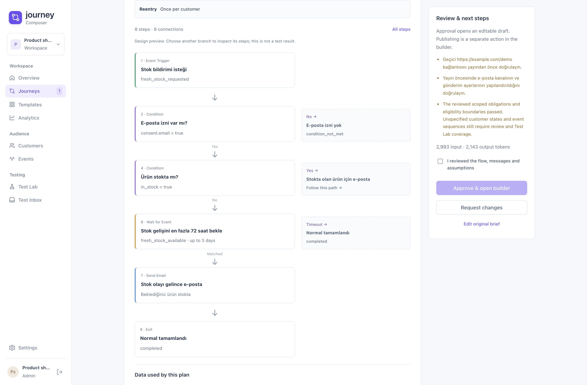
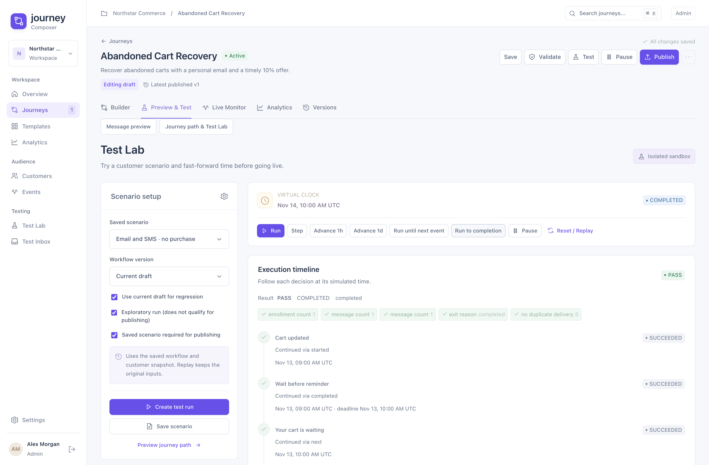
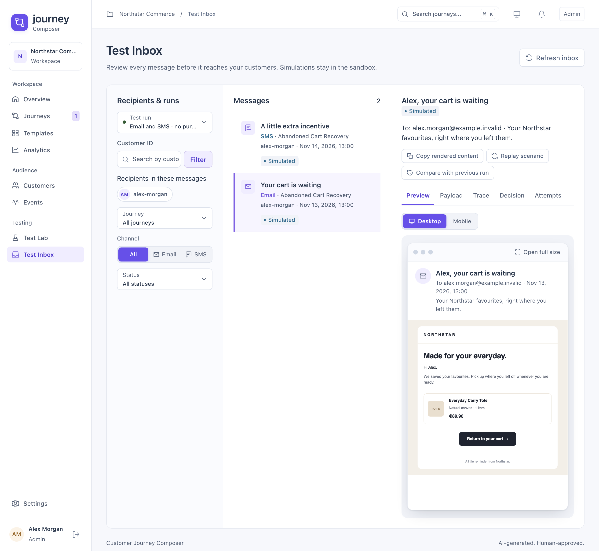
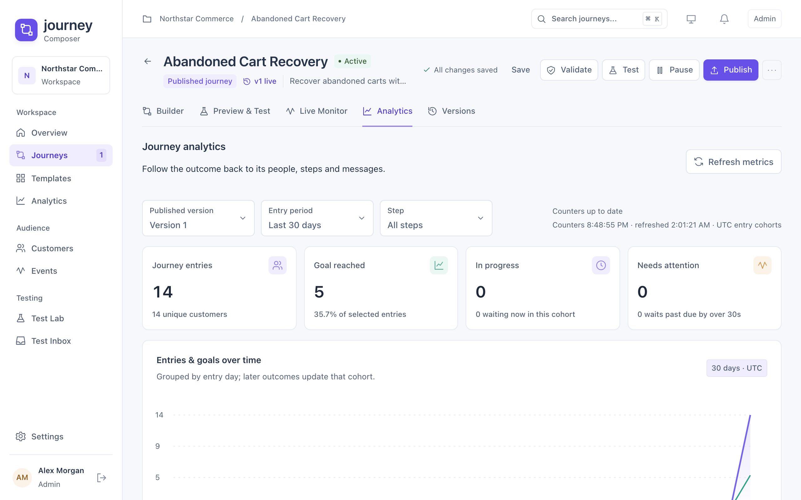

# Customer Journey Composer

Turn a customer experience brief into a visual journey you can review, test,
publish and follow customer by customer. Claude and OpenAI propose the workflow;
your team controls what is applied and activated.

**AI-generated · Human-approved · Deterministically executed**

**Describe → Review → Build → Test → Publish → Observe**

[Run locally](#run-locally) · [Product gallery](docs/images/README.md) ·
[Live validation](docs/reports/scoped-contract-live-2026-11-13.md) · [Architecture](docs/ARCHITECTURE.md)

## What you can do

| Capability                | In the product                                                                                                                                      |
| ------------------------- | --------------------------------------------------------------------------------------------------------------------------------------------------- |
| **Create with AI**        | Turn a natural-language brief into editable steps with Claude or OpenAI. Review scoped business expectations, changes and warnings before applying. |
| **Build visually**        | Connect triggers, conditions, waits, email/SMS, profile updates and exits. Edit step settings, insert branches, undo changes and autosave.          |
| **Test days in seconds**  | Advance a virtual clock, inject events and provider failures, and check expected outcomes in an isolated Test Lab.                                  |
| **Preview every message** | Personalize as a customer and inspect email/SMS, consent decisions, blocked sends and attempts in Test Inbox.                                       |
| **Run durable journeys**  | Start from real customer events. Persist waits and progress, deduplicate logical actions and recover after worker restarts.                         |
| **Follow every outcome**  | Track customer paths, inspect node/message breakdowns and compare conversions by published version and entry cohort.                                |

## From a brief to an editable journey

### 1. Describe the customer experience

Choose **New journey → Create with AI**, then write the brief in everyday language.
Start with an example or describe your own timing, channels and purchase goal.

> Recover abandoned EUR carts worth at least €50. After one hour, send a personal
> email. Wait up to 24 hours for the shopper to purchase the same cart. If they do,
> stop immediately as converted. Otherwise offer 10% off by SMS and complete.
> Respect channel consent and prevent re-entry for seven days.


### 2. Generate with visible progress

The submitted brief stays visible while the app shows the current generation
stage and elapsed time. You can cancel without silently starting another request.


### 3. Review the proposed journey

Inspect the diagram, alternative paths and scoped expected outcomes. Request a
change using another brief, or approve the proposal to open an editable draft.
Approval and publishing remain separate actions.



[Business expectations and approval](docs/images/creation/review.png) ·
[Contract editor](docs/images/creation/contract.png) ·
[Creation and persistence details](docs/design/creation-workspace.md).

### 4. Continue in the visual builder

Edit step settings and connections, personalize messages and test the result.
Brief and Review drafts reopen at their saved step after a refresh.


Workspace business terminology maps your event and field names to readable labels.
Published versions stay immutable: existing customers continue on the version they
entered while you edit a new draft.

**Real AI capture:** the creation walkthrough above was generated by OpenAI
`gpt-6-luna` through the running application, then reviewed and applied to a draft.
The captured generation took **40.9 seconds and 11,320 tokens**, including one
automatic repair. [Capture results and limitations](docs/reports/live-creation-capture-2026-11-13.md).
[Broader paid brief → workflow → test evidence](docs/reports/scoped-contract-live-2026-11-13.md).

## Fast-forward before you send

The Test Lab runs real journey decisions on an isolated virtual clock. Try a purchase before the first reminder, an opted-out customer, a duplicate event or a provider retry. Review the path and its assertions before publishing.



Simulation does not call live providers or change production customers, delivery queues or conversion metrics. Explicit **Send Test** is a separate action with recipient controls.

## See exactly what the customer would receive

Rendered email and SMS appear beside their source journey, customer, simulated time and delivery decision. Missing personalization, consent blocks and retry attempts are inspectable.



[SMS preview](docs/images/test-inbox-sms.png) · [Live customer tracking](docs/images/live-monitor.png) · [Publish review](docs/images/publish-review.png)

## Observe the result

Follow live node counts and customer paths, then compare journey and channel outcomes. Provider acceptance is reported separately from conversion; it is not presented as confirmed delivery.



**About these screenshots:** refreshed November 13, 2026 from the running local
application at **2× scale, 3200 pixels wide**. The single-journey list uses a tighter native frame. Contacts and activity are fictional; counts come
from stored records. Creation screens show a real OpenAI-generated draft from the displayed Northstar brief;
the operational demo gallery uses a separately authored recovery workflow. The application renders
its normal UI, including warnings and human approval. [Capture methods and manifests](docs/SHOWCASE.md).

Individual journeys now share version/cohort filters, readable path metrics and
node → people/messages → customer-trace drilldowns. Select and Tabs use Reka UI.
[Behavior, verification and limits](docs/design/journey-observability-implementation.md) ·
[Updated journey observation screenshots](docs/images/journey-observability/README.md).

## Verified locally — November 13, 2026

**Five fresh OpenAI journeys passed 25/25 external behavior cases** using the
shared scoped business contract. Same briefs/cases as the prior failing audit;
no manual graph edits. **49,594 tokens**, **174.17 s** generation, **216.34 s** total.
Three requests needed automatic repair. [Results, raw outputs and limits](docs/reports/scoped-contract-live-2026-11-13.md).

The local application also passed **78/78 desktop/mobile browser cases**, quality
checks and isolated HTTP/PostgreSQL integration. AI proposals remain drafts until
reviewed; publishing is a separate action. [Business contract v2](docs/BEHAVIOR-CONTRACT-V2.md)
· [Product validation](docs/PRODUCT-VALIDATION.md).

These results cover the recorded outputs and scenarios, not arbitrary brief
compliance or equivalent live Claude quality. Earlier failures and follow-ups stay
available in the [validation history](docs/reports/README.md). No external deployment
was performed.

## Run locally

Requires **Docker with Compose v2**, **Git** and **Node.js 24+** in the supported range. An AI key is optional.

```sh
git clone https://github.com/negativexq/customer-journey-composer.git
cd customer-journey-composer
make up
npm run demo:reset
```

Open **[localhost:5173](http://localhost:5173)**. The development demo login is prefilled: select **Sign in**.

`npm run demo:reset` prepares a clean **Northstar Commerce** workspace with one
**Abandoned Cart Recovery** journey, 14 fictional customers and five passing
sandbox scenarios. The previous demo workspace and history are archived; the demo
login stays the same. Other workspaces are untouched. `make demo` reuses the current
fixtures without resetting them.

The published local demo uses a 5-second reminder and 30-second purchase window,
with email sent only to local Mailpit and SMS handled by the mock provider. Its
editable draft and sandbox scenarios retain the intended 1-hour / 24-hour cadence.

| Local service        | Address                                                   |
| -------------------- | --------------------------------------------------------- |
| Application          | [localhost:5173](http://localhost:5173)                   |
| Interactive API docs | [localhost:8090/api/docs](http://localhost:8090/api/docs) |
| API readiness        | [localhost:8090/readyz](http://localhost:8090/readyz)     |
| Mailpit test inbox   | [localhost:8025](http://localhost:8025)                   |

The local stack binds to loopback. `make down` stops it while retaining PostgreSQL data. [Native development and configuration](docs/LOCAL-DEVELOPMENT.md).

## A complete recovery example

The gallery follows one **Northstar Commerce / Abandoned Cart Recovery** story:

1. A EUR cart worth at least €50 starts the journey.
2. After one hour, an eligible customer receives a personal cart reminder.
3. The journey waits up to 24 hours for a purchase of that same cart.
4. A purchase exits as converted; otherwise an eligible SMS offers `COMEBACK10`.
5. The journey completes, with a seven-day reentry cooldown.

Five saved tests cover the full path, early purchase, purchase after email,
SMS opt-out and an unrelated cart purchase. Inbox previews use Alex Morgan's
€89.90 cart and the same Northstar email/SMS content throughout.

The separate [€50+ recovery template](docs/design/abandoned-cart-eur.md) includes a
longer 48-hour final window. It remains available as a template; it is not the
new seven-step gallery journey.

## Built around durable execution

- **PostgreSQL is the source of truth:** durable jobs, row-locked transitions, leases, fencing tokens and recovery after worker restarts.
- **Logical actions are idempotent:** event deduplication, unique action identities and a transactional outbox protect retries.
- **Policy is enforced at execution:** consent, frequency reservations, lifecycle state and global exits are checked before dispatch.
- **Workspaces are isolated:** session/API-key boundaries, Admin/Editor/Viewer roles and audit records are enforced by the API.
- **Observability follows the work:** structured logs, OpenTelemetry traces, Prometheus metrics and a local Grafana/Tempo stack.

External provider outcomes can be ambiguous; the system preserves that state rather than claiming universal exactly-once delivery. [Runtime architecture](docs/ARCHITECTURE.md) · [Security and data policies](docs/SECURITY.md).

## Stack and verification

**Vue 3 + TypeScript · Vue Flow 2 (`@xyflow/vue`) · Go · PostgreSQL · Docker Compose**

The Vue Flow preview version is explicitly pinned to `2.0.0-next.21`. Email uses an SMTP adapter with Mailpit for local tests; SMS uses a mock adapter in the MVP. Claude and OpenAI share a versioned workflow schema and proposal interface.

Authorized live OpenAI audits are indexed in the [validation history](docs/reports/README.md). Live Claude quality remains unverified. Deterministic provider-contract, validation, approval and simulation tests run without paid model requests. AI never applies or publishes a proposal automatically. [AI configuration](docs/AI.md).

```sh
make install
make check
make test-integration
make test-e2e
make test-recovery
```

The latest recorded local browser run passed **90/90 desktop/mobile scenarios**, including real canvas connections, branch insertion/undo, access recovery, sandbox isolation, customer tracking, a customer's route on the journey map and light/dark theme behavior. Database integration tests use isolated PostgreSQL containers. Hosted CI also checks dependencies and application images.

Measured 10,000-execution workloads, raw results and limitations are available in the [performance reports](docs/PERFORMANCE.md), [operational follow-up](docs/OPERATIONS-PERFORMANCE.md), [bounded-turn analysis](docs/BOUNDED-TURNS.md), [scheduler transaction tradeoffs](docs/SCHEDULER-LOCKS.md) and [latest queue/timer follow-up](docs/QUEUE-FOLLOWUP.md). They describe their own source revisions and matched baselines; they are not universal latency promises.

For the local monitoring stack:

```sh
make observe-up
make test-telemetry
```

## Explore the project

[Product requirements](docs/PRD.md) · [Implementation status](docs/IMPLEMENTATION.md) · [API policies](docs/API.md) · [Analytics semantics](docs/ANALYTICS.md) · [Observability](docs/OBSERVABILITY.md) · [Design direction](docs/design/modern-saas-direction.md)

Contributions follow the repository [working agreement](AGENTS.md): verified, focused Conventional Commits; formatting, lint, typecheck and relevant tests before committing. Secrets, `.env` files and real customer data do not belong in Git.

Journey observation load validation: [10,000 active executions, API latency and
projection lag](docs/JOURNEY-OBSERVABILITY-PERFORMANCE.md). Counts reconciled with
zero duplicate actions; the report includes the measured queue-lag limitation.
