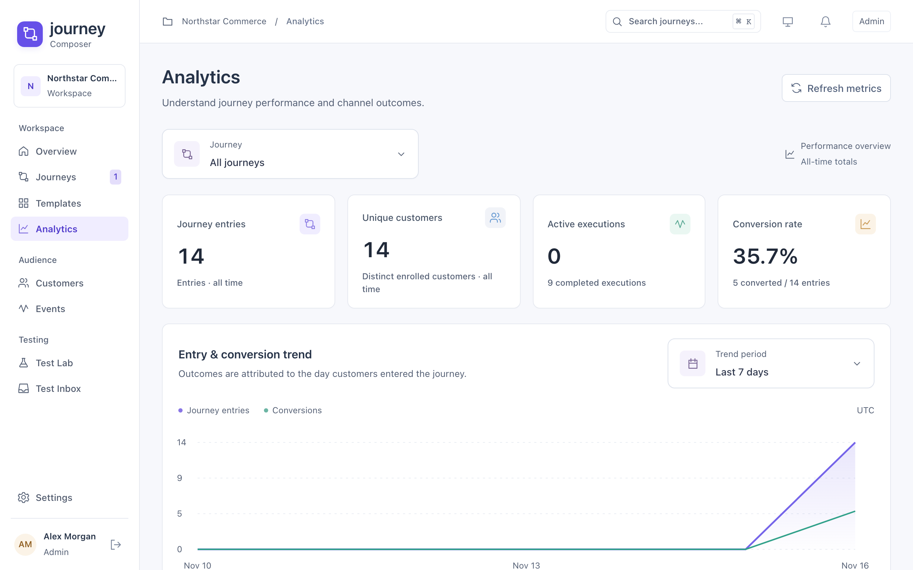

# Customer Journey Composer

**Design the journey. Test every decision. Stay in control.**

An AI-powered customer journey workspace with a visual builder, a persistent execution engine and a virtual-time Test Lab. Describe a customer experience, review the proposed workflow, preview its messages and follow each customer after publishing.

**AI-generated · Human-approved · Deterministically executed**


[Try locally](#run-locally) · [Product gallery](docs/images/README.md) · [Architecture](docs/ARCHITECTURE.md) · [CI](https://github.com/negativexq/customer-journey-composer/actions/workflows/ci.yml)

## From customer event to customer experience

| Workspace              | What you can do                                                                                                                 |
| ---------------------- | ------------------------------------------------------------------------------------------------------------------------------- |
| **Journey Builder**    | Connect triggers, conditions, waits, email/SMS and exits. Insert steps on a branch, edit in context and undo changes.           |
| **AI Composer**        | Use Claude or OpenAI to propose a typed workflow or message. Inspect the diff and assumptions before applying it.               |
| **Preview & Test Lab** | Preview as a customer, fast-forward hours or days, inject events and provider failures, and check expected outcomes.            |
| **Test Inbox**         | Inspect the exact rendered email or SMS, personalization, consent decision and provider attempts for each test run.             |
| **Live Monitor**       | Track a customer on their published version. Inspect the current step, wait deadline, transition history and message decisions. |
| **Analytics**          | Compare entries, conversions and channel outcomes using persisted execution data and indexed projections.                       |

A published workflow is an immutable snapshot. Existing customers continue on the version they entered; editing a draft does not silently change their journey.

## Fast-forward before you send

The Test Lab runs real journey decisions on an isolated virtual clock. Try a purchase before the first reminder, an opted-out customer, a duplicate event or a provider retry. Review the path and its assertions before publishing.


Simulation does not call live providers or change production customers, delivery queues or conversion metrics. Explicit **Send Test** is a separate action with recipient controls.

## See exactly what the customer would receive

Rendered email and SMS appear beside their source journey, customer, simulated time and delivery decision. Missing personalization, consent blocks and retry attempts are inspectable.


[SMS preview](docs/images/test-inbox-sms.png) · [Live customer tracking](docs/images/live-monitor.png) · [Publish review](docs/images/publish-review.png)

## Observe the result

Follow live node counts and customer paths, then compare journey and channel outcomes. Provider acceptance is reported separately from conversion; it is not presented as confirmed delivery.



**About these screenshots:** all contacts and activity are synthetic demo data. Live demo actions use mock SMS; email previews are isolated simulations. Counts come from stored records, and the demo does not invent historical trends, email opens or click rates. Images are captured from the running application at **3200 × 2100**, with no UI values substituted. [Capture details](docs/SHOWCASE.md).

## Run locally

Requires **Docker with Compose v2**, **Git** and **Node.js 24+** in the supported range. An AI key is optional.

```sh
git clone https://github.com/negativexq/customer-journey-composer.git
cd customer-journey-composer
make up
make demo
```

Open **[localhost:5173](http://localhost:5173)**. The development demo login is prefilled: select **Sign in**.

`make demo` adds 54 fictional customer profiles, 72 local demo enrollments, Active/Paused/Sunset journeys, a draft campaign and recovery test scenarios. Re-running a completed seed preserves its fixture identities. Existing workspace data is retained. The demo account is development-only; this command does not deploy the application.

| Local service        | Address                                                   |
| -------------------- | --------------------------------------------------------- |
| Application          | [localhost:5173](http://localhost:5173)                   |
| Interactive API docs | [localhost:8090/api/docs](http://localhost:8090/api/docs) |
| API readiness        | [localhost:8090/readyz](http://localhost:8090/readyz)     |
| Mailpit test inbox   | [localhost:8025](http://localhost:8025)                   |

The local stack binds to loopback. `make down` stops it while retaining PostgreSQL data. [Native development and configuration](docs/LOCAL-DEVELOPMENT.md).

## A complete recovery example

The **Abandoned Cart · €50+** template includes:

1. Qualify a EUR cart worth at least €50 and wait one hour.
2. Send a personalized email when the customer has consent and has not purchased.
3. Wait up to 24 hours for a purchase, then offer a consented SMS with `COMEBACK10`.
4. Wait another 48 hours and finish with the recorded conversion outcome.

Purchase events can exit the journey immediately. A seven-day reentry cooldown prevents repeat enrollment while permitting the email and SMS in the same execution. The Test Lab includes five A–E customer scenarios. [Full example contract](docs/design/abandoned-cart-eur.md).

The optional live showcase uses separate accelerated fixtures; it leaves the original recovery draft and its 1h/24h/48h timing intact.

## Built around durable execution

- **PostgreSQL is the source of truth:** durable jobs, row-locked transitions, leases, fencing tokens and recovery after worker restarts.
- **Logical actions are idempotent:** event deduplication, unique action identities and a transactional outbox protect retries.
- **Policy is enforced at execution:** consent, frequency reservations, lifecycle state and global exits are checked before dispatch.
- **Workspaces are isolated:** session/API-key boundaries, Admin/Editor/Viewer roles and audit records are enforced by the API.
- **Observability follows the work:** structured logs, OpenTelemetry traces, Prometheus metrics and a local Grafana/Tempo stack.

External provider outcomes can be ambiguous; the system preserves that state rather than claiming universal exactly-once delivery. [Runtime architecture](docs/ARCHITECTURE.md) · [Security and data policies](docs/SECURITY.md).

## Stack and verification

**Vue 3 + TypeScript · Vue Flow 2 (`@xyflow/vue`) · Go · PostgreSQL · Docker Compose**

The Vue Flow preview version is explicitly pinned to `2.0.0-next.21`. Email uses an SMTP adapter with Mailpit for local tests; SMS uses a mock adapter in the MVP. Claude and OpenAI share a versioned workflow schema and proposal interface.

Live LLM evaluation remains deferred. Local provider contracts, validation, approval and simulation tests run without paid model requests. AI never applies or publishes a proposal automatically. [AI configuration](docs/AI.md).

```sh
make install
make check
make test-integration
make test-e2e
make test-recovery
```

The browser suite covers **46 desktop/mobile scenarios**, including real canvas connections, branch insertion/undo, access recovery, sandbox isolation, customer tracking and dark-OS/light-canvas behavior. Database integration tests use isolated PostgreSQL containers. Hosted CI also checks dependencies and application images.

Measured 10,000-execution workloads, raw results and limitations are available in the [performance reports](docs/PERFORMANCE.md), [operational follow-up](docs/OPERATIONS-PERFORMANCE.md), [bounded-turn analysis](docs/BOUNDED-TURNS.md), [scheduler transaction tradeoffs](docs/SCHEDULER-LOCKS.md) and [latest queue/timer follow-up](docs/QUEUE-FOLLOWUP.md). They describe their own source revisions and matched baselines; they are not universal latency promises.

For the local monitoring stack:

```sh
make observe-up
make test-telemetry
```

## Explore the project

[Product requirements](docs/PRD.md) · [Implementation status](docs/IMPLEMENTATION.md) · [API policies](docs/API.md) · [Analytics semantics](docs/ANALYTICS.md) · [Observability](docs/OBSERVABILITY.md) · [Design direction](docs/design/modern-saas-direction.md)

Contributions follow the repository [working agreement](AGENTS.md): verified, focused Conventional Commits; formatting, lint, typecheck and relevant tests before committing. Secrets, `.env` files and real customer data do not belong in Git.
