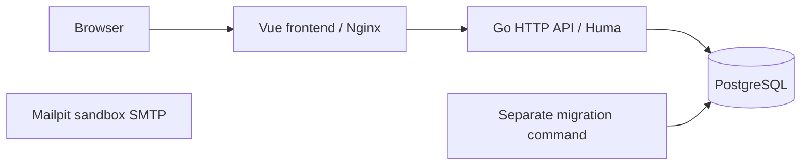

# Architecture

## Implemented foundation

The frontend uses same-origin endpoints: Vite proxies during native development, Nginx proxies in Docker. This avoids permissive CORS and keeps provider secrets out of the browser. Fonts are packaged locally; rendering does not require a third-party font service.

The API uses Go's HTTP server and Huma typed operations to generate OpenAPI. `/healthz` describes process liveness; `/readyz` verifies database connectivity and applied migration checksums with a two-second deadline. HTTP timeouts and SIGTERM/interrupt draining bound startup and shutdown. JSON logs omit request bodies, query strings and database credentials.

PostgreSQL is accessed through a bounded pgx pool (maximum 20 connections per process). Connection configuration and startup failures do not echo the database URL. The first migration creates workspaces with database-enforced UUID identity, unique slug and validated name/slug fields.

Migrations are embedded in the migration binary, sorted, and executed inside one transaction protected by a transaction advisory lock. Each applied file has a SHA-256 checksum; editing applied SQL is rejected. Failed batches roll back. `migrate` is a distinct deployment command; the API does not implicitly alter schemas. Docker orders startup by database health, migration success, then API readiness.

The Docker setup persists PostgreSQL on a named volume, runs the Go service as a non-root user, uses unprivileged Nginx, and binds host ports to loopback. Random local credentials live only in the ignored `.env`. This development configuration is not a production deployment.

## Planned domain boundaries

These are design constraints, not implemented features:

- **Identity and workspace:** password/session authentication, role checks and workspace-scoped repositories. Workspace IDs come from authenticated identity, never blindly from a payload.
- **Workflow:** versioned typed node configuration, graph/business validation, editable drafts, immutable published snapshots. Executions reference their starting version.
- **Events:** schema validation, workspace API keys, unique `(workspace_id, event_id)`, persisted matching and atomic enrollment. Defined late-event policy.
- **Runtime:** deterministic state transitions, condition evaluation, shared Clock abstraction. PostgreSQL stores steps, jobs, waiters and outbox. Workers claim due work with `FOR UPDATE SKIP LOCKED`, lease expiry and fencing tokens.
- **Concurrency:** execution state transitions serialize under a row lock. Event/timeout/global exit race against the same state. Unique constraints enforce active enrollment and logical delivery identity. Workers recheck terminal and pause state before scheduling actions.
- **Delivery:** eligibility, consent and workspace frequency-cap decisions recorded separately from provider attempts. A unique logical job owns bounded retries. External outcome ambiguity is explicit; provider acceptance is not proof of delivery.
- **AI:** Anthropic Claude and OpenAI adapters behind a common interface; shared JSON schema and graph validation; bounded repair; no runtime-rule modification. Proposals produce a diff and require Apply/Discard. Publish is always a separate human action.
- **Simulation:** the same deterministic semantics with virtual time, copied customer data, isolated test persistence and sandbox providers. No production jobs, metrics or customer mutation. Test Inbox records rendered content and decision traces.
- **Monitoring:** execution/step/delivery facts power polling or SSE views and metrics with explicit denominators. Retries do not inflate logical send counts.

## Testing strategy

Each phase adds tests for its acceptance criteria. The foundation currently covers HTTP health/readiness and generated OpenAPI, configuration, Conventional Commit validation, real PostgreSQL migration concurrency/constraints/checksums/reconnection, and desktop/mobile browser success/error states.

Later phases must cover all scenarios A–H from the PRD, including races and restarts on a real PostgreSQL instance. Mocked LLM outputs test invalid/incomplete proposals; live LLM evaluation is postponed. Load testing must actually create 10,000 active executions and report measured p50/p95/p99 rather than assumed performance.

## Security and data handling

The foundation has no customer data or identity endpoints. API auth, RBAC, hashed workspace API keys, consent policies, HTML sanitization, recipient allowlists, rate limits, audit logs and OpenTelemetry arrive in their planned phases and remain required before production use.

Before customer ingestion is released, define configurable retention for event payloads, delivery content and test runs, workspace-authorized customer deletion/anonymization, PII-masked audit/trace fields, and deletion of related test snapshots. Document backup retention and deletion timing before production deployment. These policies are pending implementation; the initial workspace schema is not a substitute.

## Sources for foundation tooling

- [Vue TypeScript setup](https://vuejs.org/guide/quick-start.html)
- [Vite guide](https://vite.dev/guide/)
- [pgxpool documentation](https://pkg.go.dev/github.com/jackc/pgx/v5/pgxpool)
- [Huma project](https://github.com/danielgtaylor/huma)

## PostgreSQL performance requirements (accepted user steering)

Analytics must not add unbounded scans or expensive synchronous reporting work to execution transactions. Use workspace/time predicates, bounded pages, deterministic index-compatible ordering, and batch reads instead of per-row queries. Add composite/partial/covering indexes only for implemented access paths; avoid unnecessary indexes that amplify event/job writes. Prefix tenant-facing access paths with workspace identity, and index foreign-key/claim lookups where measured workloads require it.

For phase 10, maintain idempotent metric facts or deltas from runtime transitions, asynchronously aggregate them in bounded batches, and serve routine dashboard/trend/channel queries from indexed daily summaries. Show aggregation freshness. Customer/execution detail views must remain available from authoritative records. Define unique-customer denominators explicitly; summing daily distinct counts is not a valid period distinct count. Retry attempts must not increment logical-send totals.

At the performance phase, seed at least 10,000 active executions and record EXPLAIN (ANALYZE, BUFFERS) for real dashboard, customer tracking, due-job claiming, event matching and trend queries. Record throughput and p50/p95/p99, pool pressure and query plans; report actual results and adjust indexes/batch sizes accordingly. Partitioning and additional caches require measured justification.
