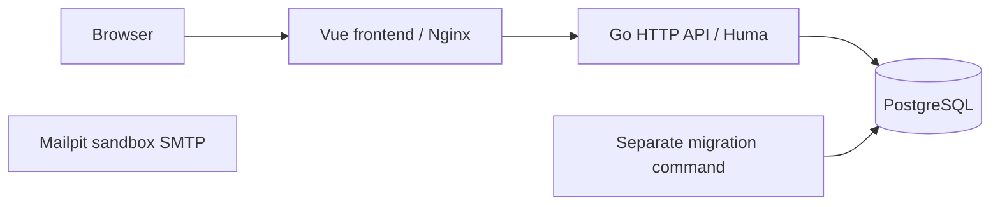

# Architecture

## Implemented foundation

The frontend uses same-origin endpoints: Vite proxies during native development, Nginx proxies in Docker. This avoids permissive CORS and keeps provider secrets out of the browser. System UI fonts require no font downloads or third-party font service.

The API uses Go's HTTP server and Huma typed operations to generate OpenAPI. `/healthz` describes process liveness; `/readyz` verifies database connectivity and applied migration checksums with a two-second deadline. HTTP timeouts and SIGTERM/interrupt draining bound startup and shutdown. JSON logs omit request bodies, query strings and database credentials.

PostgreSQL is accessed through a bounded pgx pool (maximum 20 connections per process). Connection configuration and startup failures do not echo the database URL. The first migration creates workspaces with database-enforced UUID identity, unique slug and validated name/slug fields.

Migrations are embedded in the migration binary, sorted, and executed inside one transaction protected by a transaction advisory lock. Each applied file has a SHA-256 checksum; editing applied SQL is rejected. Failed batches roll back. `migrate` is a distinct deployment command; the API does not implicitly alter schemas. Docker orders startup by database health, migration success, then API readiness.

The Docker setup persists PostgreSQL on a named volume, runs the Go service as a non-root user, uses unprivileged Nginx, and binds host ports to loopback. Random local credentials live only in the ignored `.env`. This development configuration is not a production deployment.

## Implemented domain boundaries

Runtime jobs execute bounded short-node turns (up to eight nodes, soft 10ms checks between nodes) under the existing fences. Timers yield before dependent work; messages, attribute mutations, waits and terminal states are boundaries. All node histories remain persisted, while redundant intra-transaction RUNNING writes and scheduler round trips are reduced. [Measurements and transaction semantics](BOUNDED-TURNS.md) include remaining lock contention.

The implemented services enforce the following boundaries:

- **Identity and workspace:** password/session authentication, role checks and workspace-scoped repositories. Workspace IDs come from authenticated identity, never blindly from a payload.
- **Workflow:** versioned typed node configuration, graph/business validation, editable drafts, immutable published snapshots. Executions reference their starting version.
- **Events:** schema validation, workspace API keys, unique `(workspace_id, event_id)`, persisted matching and atomic enrollment. Defined late-event policy.
- **Runtime:** deterministic state transitions, condition evaluation, shared Clock abstraction. PostgreSQL stores steps, jobs, waiters and outbox. Workers claim due work with `FOR UPDATE SKIP LOCKED`, lease expiry and fencing tokens.
- **Concurrency:** execution state transitions serialize under a row lock. Event/timeout/global exit race against the same state. Unique constraints enforce active enrollment and logical delivery identity. Workers recheck terminal and pause state before scheduling actions.
- **Delivery:** eligibility, consent and workspace frequency-cap decisions recorded separately from provider attempts. A unique logical job owns bounded retries. External outcome ambiguity is explicit; provider acceptance is not proof of delivery.
- **AI:** Anthropic Claude and OpenAI adapters behind a common interface; shared JSON schema and graph validation; bounded repair; no runtime-rule modification. Proposals produce a diff and require Apply/Discard. Publish is always a separate human action.
- **Simulation:** the same deterministic semantics with virtual time, copied customer data, isolated test persistence and sandbox providers. No production jobs, metrics or customer mutation. Test Inbox records rendered content and decision traces.
- **Monitoring:** execution/step/delivery facts power polling or SSE views and metrics with explicit denominators. Retries do not inflate logical send counts.

## Testing strategy

Each phase adds tests for its acceptance criteria. Coverage includes HTTP health/readiness/OpenAPI, configuration, commit validation, migration concurrency/constraints/checksums, graph rules, workspace isolation, execution/delivery races and recovery, sandbox isolation, metric projections and desktop/mobile flows.

Real PostgreSQL tests cover races and recovery; the Docker restart check exercises an actual process restart. Local provider contracts and mocked browser proposals cover invalid/incomplete LLM outputs; live LLM evaluation is postponed. The [performance report](PERFORMANCE.md) records actual 10,000-active-execution runs and p50/p95/p99 with sampling limits.

## Security and data handling

Authentication/RBAC, workspace isolation, hashed ingestion API keys, consent policies, HTML sanitization, recipient allowlists, request limits, atomic audit and OpenTelemetry propagation are implemented. Provider secrets stay on the server. Development-only generated demo credentials are refused in production.

Retention, authorized erasure, PII masking, test snapshots and backup deletion timing are documented in [SECURITY.md](SECURITY.md). They are operating policies; the application does not claim to provide an automatic retention/deletion scheduler.

## Sources for foundation tooling

- [Vue TypeScript setup](https://vuejs.org/guide/quick-start.html)
- [Vite guide](https://vite.dev/guide/)
- [pgxpool documentation](https://pkg.go.dev/github.com/jackc/pgx/v5/pgxpool)
- [Huma project](https://github.com/danielgtaylor/huma)

## PostgreSQL performance requirements (accepted user steering)

Analytics must not add unbounded scans or expensive synchronous reporting work to execution transactions. Use workspace/time predicates, bounded pages, deterministic index-compatible ordering, and batch reads instead of per-row queries. Add composite/partial/covering indexes only for implemented access paths; avoid unnecessary indexes that amplify event/job writes. Prefix tenant-facing access paths with workspace identity, and index foreign-key/claim lookups where measured workloads require it.

For phase 10, maintain idempotent metric facts or deltas from runtime transitions, asynchronously aggregate them in bounded batches, and serve routine dashboard/trend/channel queries from indexed daily summaries. Show aggregation freshness. Customer/execution detail views must remain available from authoritative records. Define unique-customer denominators explicitly; summing daily distinct counts is not a valid period distinct count. Retry attempts must not increment logical-send totals.

At the performance phase, seed at least 10,000 active executions and record EXPLAIN (ANALYZE, BUFFERS) for real dashboard, customer tracking, due-job claiming, event matching and trend queries. Record throughput and p50/p95/p99, pool pressure and query plans; report actual results and adjust indexes/batch sizes accordingly. Partitioning and additional caches require measured justification.

### Isolated deterministic testing (phase 8)

The sandbox has no database/provider handle. It shares the production pure node decision, attribute mutation and eligibility functions. A virtual task queue drives time; production workers retain PostgreSQL timers. HTTP orchestration snapshots workflow/customer/policy inputs and stores sandbox state in separate tables. Workflow definitions are content-addressed per workspace; message bodies are inserted once outside frequently updated state. Run mutations lock one sandbox row and require an optimistic revision, without touching live customer/event/execution/delivery tables. A replay preserves original inputs, while regression explicitly selects a newer workflow.

### Measured queue access paths

Runtime/delivery claims retain ordered pending/due indexes as their outer access path and apply one-to-one lifecycle eligibility before LIMIT. Process/dispatch still recheck state under the established customer/journey/execution/job lock order. Fence validation materializes the exact scoped job lookup before state/token/deadline filtering, preventing a scan of the small claimed-lease partial index on every step. Enrollment uses the existing partial unique active-execution constraint; only once/cooldown modes need history queries. [Measured plans and costs](PERFORMANCE.md) explain the changes; no migration/index was added for this optimization.

The delivery scheduler commits one action before acquiring another customer's lock, retaining a bounded drain budget of 32 actions. Fresh lifecycle/pending/frequency reads follow customer locking; delivery creation and outbox acknowledgement are atomic. The [scheduler measurements](SCHEDULER-LOCKS.md) distinguish reduced lock scope from the remaining per-action claim/commit overhead and slower mock-send drain versus the original baseline. Event inspection separately adds the workspace/event/history index in migration 0018.

Within a drain, `(created_at,id)` continuation seeks avoid repeatedly scanning the pending prefix; the cursor advances after commit and resets each drain so earlier skipped/backdated work is revisited. Runtime customer/journey/execution reads share a pgx transport batch but remain separate statements in lock order. The lease fence and its clock stay after that batch. [Queue follow-up measurements](QUEUE-FOLLOWUP.md) cover correctness, observed gains and remaining overhead. Benchmark deadline spreading changes only isolated fixture jobs, never production wait times.

### Required test acceptance

Publication checks the latest full acceptance run for every saved required case
and every inline case exercised against the exact workflow hash. Saved cases
remain required across draft changes and must be regressed on the current draft;
overriding a saved scenario does not fulfill its original requirement. Replay
preserves scenario identity and can supersede an earlier failed result. Saved
cases may be explicitly marked optional with an audit record; exploratory runs
never qualify a journey for publication. Test creation and requirement changes
serialize with publication on the journey row. Migration 0019 adds sandbox-only
acceptance metadata and indexes; production worker state and old snapshots are
unchanged.

### Reviewed AI behavior contract

`composer.v2` constrains newly generated exit reasons to documented outcome codes;
manual custom reasons and existing published versions retain their semantics.
The EUR recovery brief selects `cart-recovery-eur.v1`, persisted as optional
workflow metadata. Its bounded, no-I/O acceptance checks run during composition,
validation and pre-launch review, including profile-only purchase decisions,
channel consent, amount/currency boundaries and cooldown. Unselected general
workflows explicitly warn that graph validity is not brief compliance. Workers
do not interpret this metadata or automatically rewrite graphs. The original
Luna fixture is retained; a separate, explicitly reviewed correction adds the
missing decisions and is tested without further model calls.

### AI generation accounting

Both provider adapters return a structured result with actual/requested model,
request ID, duration and provider-reported token counters. Composer aggregates
all attempts, including rejected candidates and bounded repairs. Missing usage
remains unknown; partial counters are retained per attempt without presenting an
incomplete sum as an exact total. Anthropic cache-read/creation input is included
in normalized input totals; its unreported reasoning breakdown stays unknown.
Sanitized metadata is persisted in workspace audit logs on success and failure,
including after client cancellation, with a bounded accounting timeout. Prompts,
customer content, output bodies, secrets and private reasoning are excluded.

### AI generation lifecycle feedback

The existing JSON generation routes remain supported. Opt-in POST `/stream`
variants emit SSE frames for accepted, provider generation, validation,
bounded repair/retry and terminal proposal/error. These events describe
orchestration boundaries, never model reasoning. One request uses the same
workspace guard, bounded Composer attempts and usage audit as JSON generation.
The final proposal is emitted only after accounting succeeds. A five-second
heartbeat and disabled Nginx proxy buffering keep the stream observable;
disconnect cancels the provider context. This is request-scoped, not a durable
background generation job and does not promise reload recovery. The frontend
never automatically reconnects or resubmits a paid generation action.
