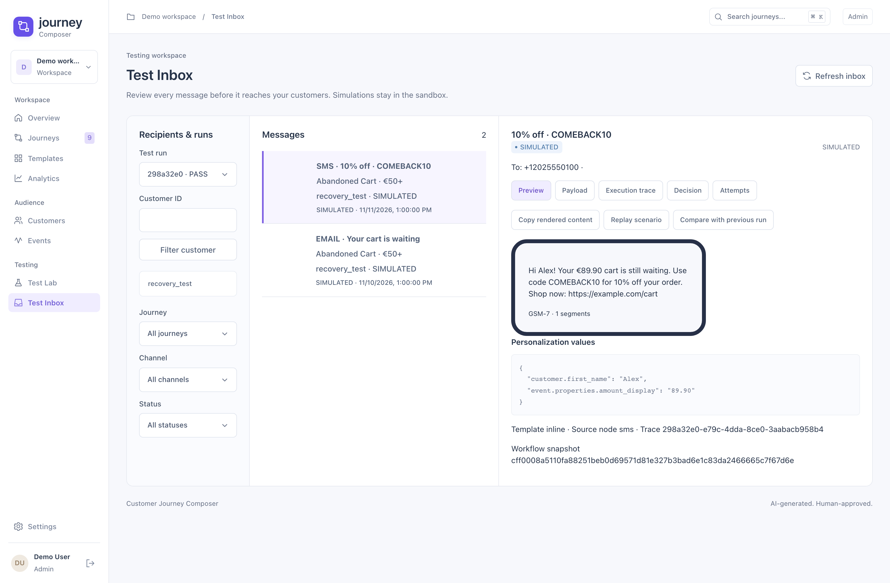
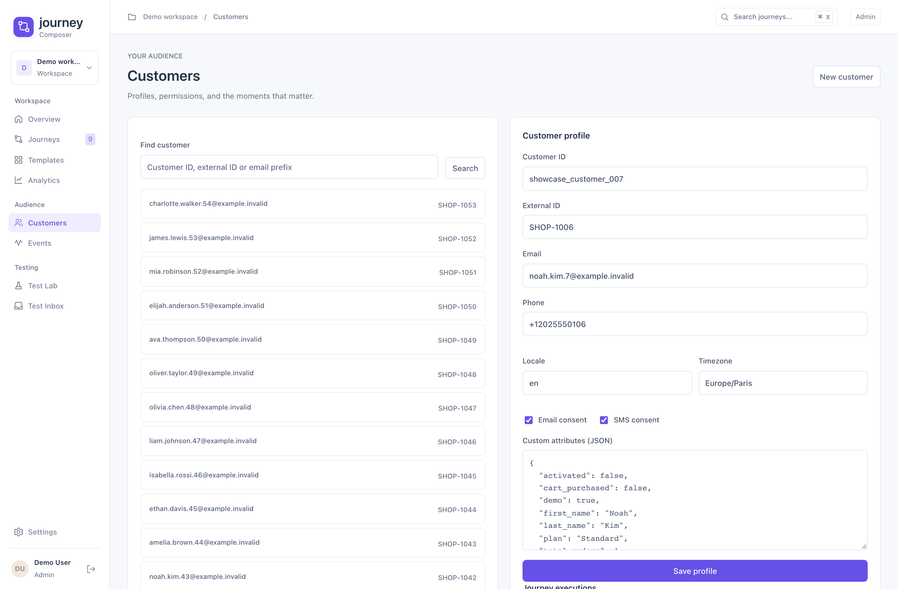
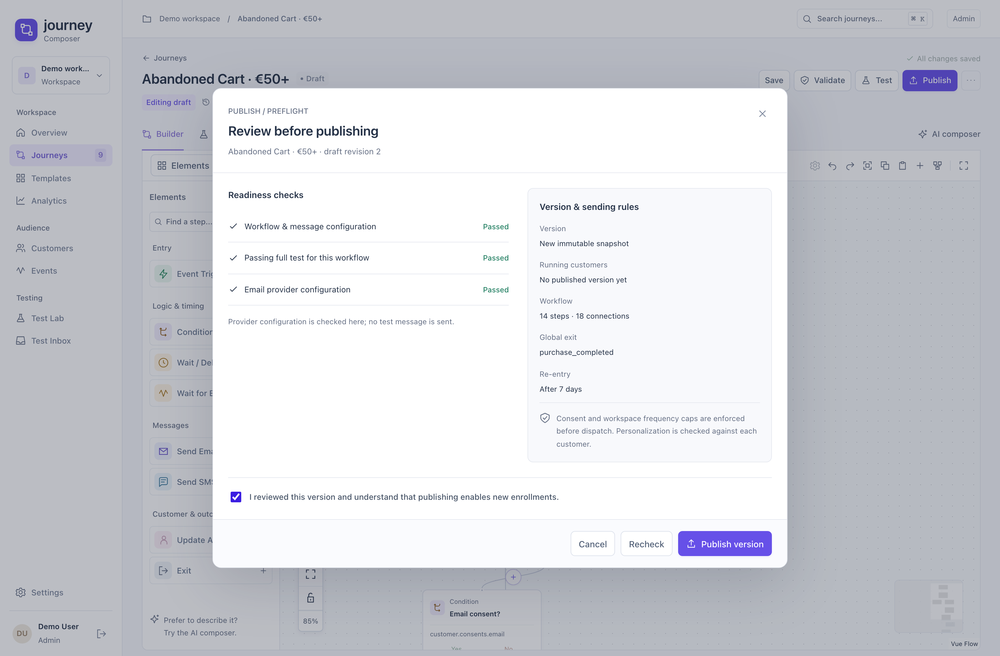

# Product gallery

Real application captures at **3200 × 2100** (2× display scale). All customers are fictional. Counts come from persisted local demo activity; live actions use mock SMS, while email previews use isolated simulations. No historical activity or open/click rates are invented.

[Run the demo or reproduce these captures](../SHOWCASE.md) · [Capture manifest](manifest.json) · [Project README](../../README.md)

## Overview

Workspace totals, recent journeys and operational activity.

## Journeys

Compact journey management with draft, active, paused and sunset examples.

## Visual Builder

Searchable Elements, branch insertion and a contextual step inspector on a light canvas.

## Test Lab

Virtual time, saved recovery scenarios, assertions and execution history.

## Email preview

Personalized email from an isolated recovery simulation.

## SMS preview

Rendered recovery SMS with customer details and the sample discount code.

## Live Monitor

An enrolled customer waiting on their immutable published workflow version.

## Analytics

Entries, conversions and channel outcomes from the local execution engine. The demo is created on the actual current day, so earlier dates remain empty.

## Customers

Fictional profiles and their communication preferences.

## Publish review

Review and acknowledgement before activation. Capturing this screen does not publish the recovery draft.

