# Product gallery

Refreshed November 17, 2026. Real application captures at a 1280 × 800 CSS viewport and 2× display scale (**2560 × 1600 PNGs**). The single-journey list is shorter, and the email preview and publish review are taller so they show whole. One clean Northstar workspace, one Abandoned Cart Recovery journey and 14 fictional customers. Live email uses local Mailpit, push and SMS use the mock providers and Inbox previews use isolated simulations. No historical activity or open/click rates are invented.

[Run the demo or reproduce these captures](../SHOWCASE.md) · [Capture manifest](manifest.json) · [Project README](../../README.md)

## Overview

Workspace totals, recent journeys and operational activity.

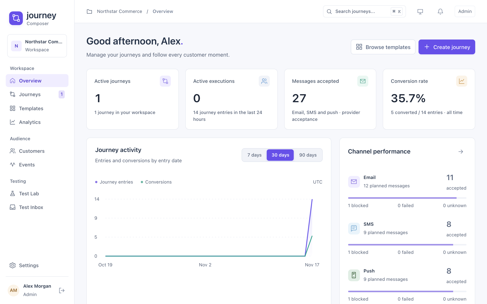

## Journeys

The new Abandoned Cart Recovery journey, with no old scratch names or audit drafts.

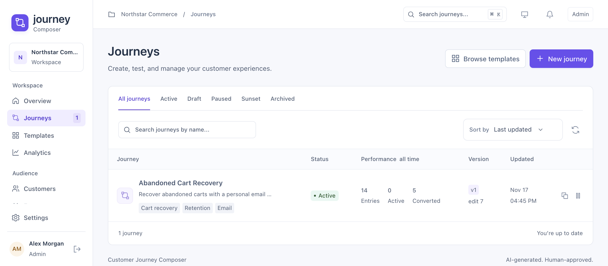

## Visual Builder

Searchable Elements, branch insertion and a contextual step inspector on a light canvas.

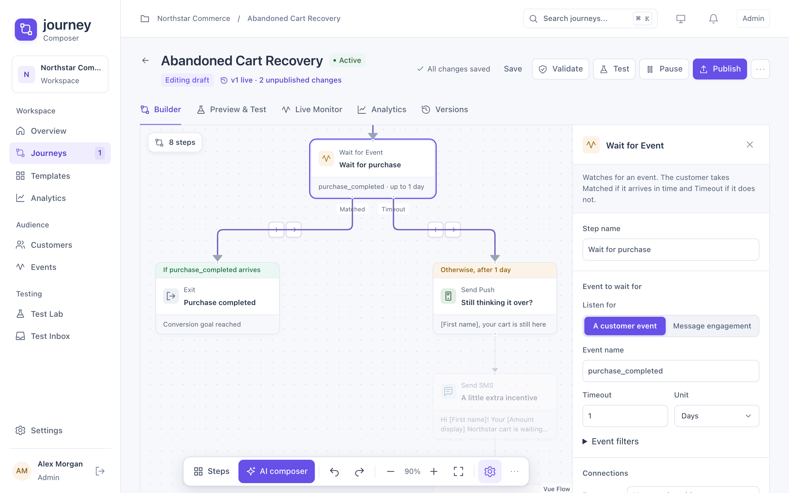

## AI creation and scoped review

A dedicated brief page, per-situation business expectations, visible generation
progress and human approval before the editable canvas. These captures replay
the showcase recipe as a recorded generation stream, so they need no provider key;
the November 13 gallery came from a real OpenAI `gpt-6-luna` response
([run evidence](../reports/live-creation-capture-2026-11-13.md)).

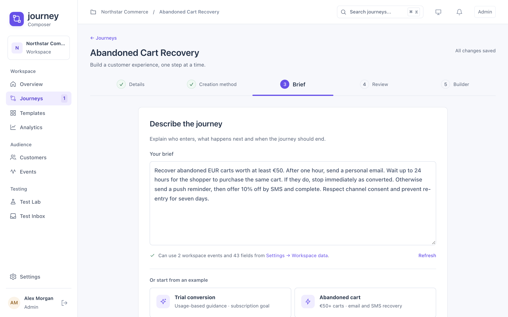

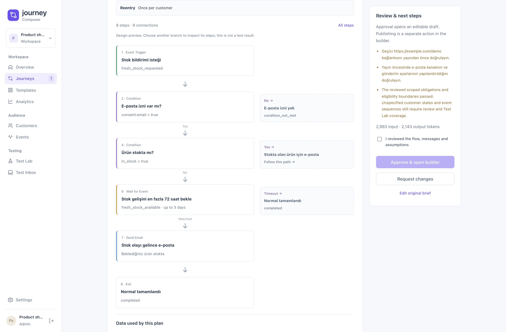

[Brief](creation/brief.png) · [Contract editor](creation/contract.png) ·
[Generation feedback](creation/generating.png) · [Path diagram](creation/review-diagram.png)
· [Creation gallery and manifest](creation/README.md).

## Test Lab

Virtual time, saved recovery scenarios, assertions and execution history.

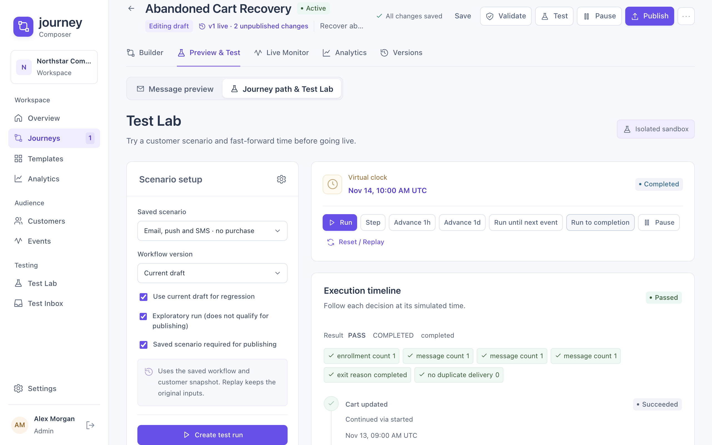

## Email preview

Personalized email from an isolated recovery simulation.

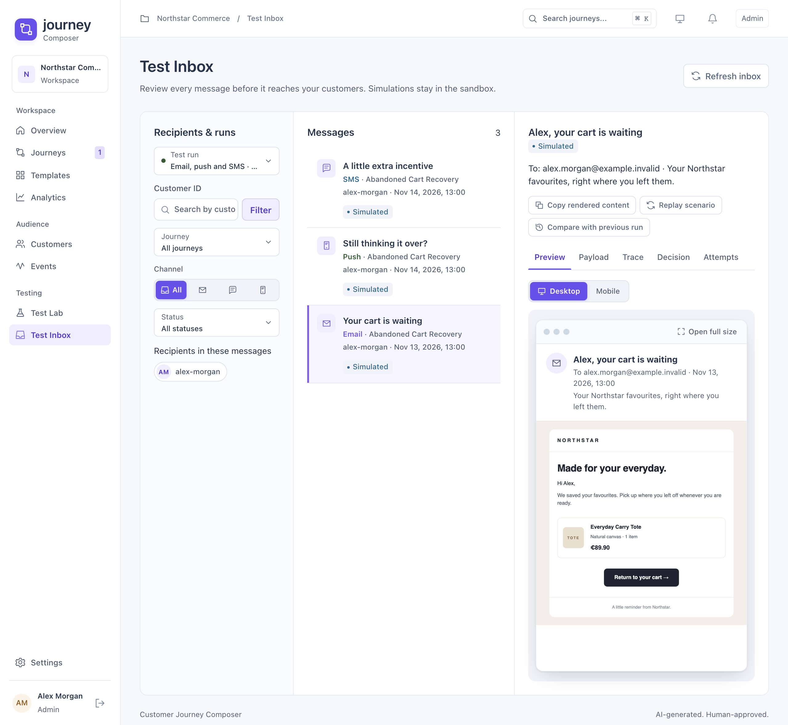

## Push preview

The push follow-up as a banner on the customer's phone, with its device token and delivery tabs.

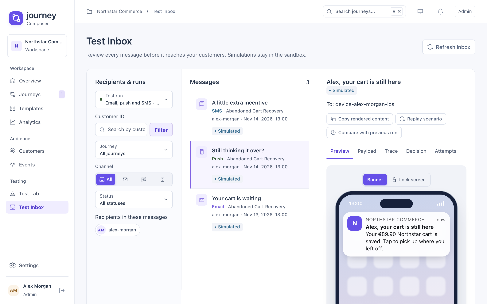

## SMS preview

Rendered recovery SMS with customer details and the sample discount code.

## Live Monitor

An enrolled customer's path and delivery history on their immutable published workflow version.

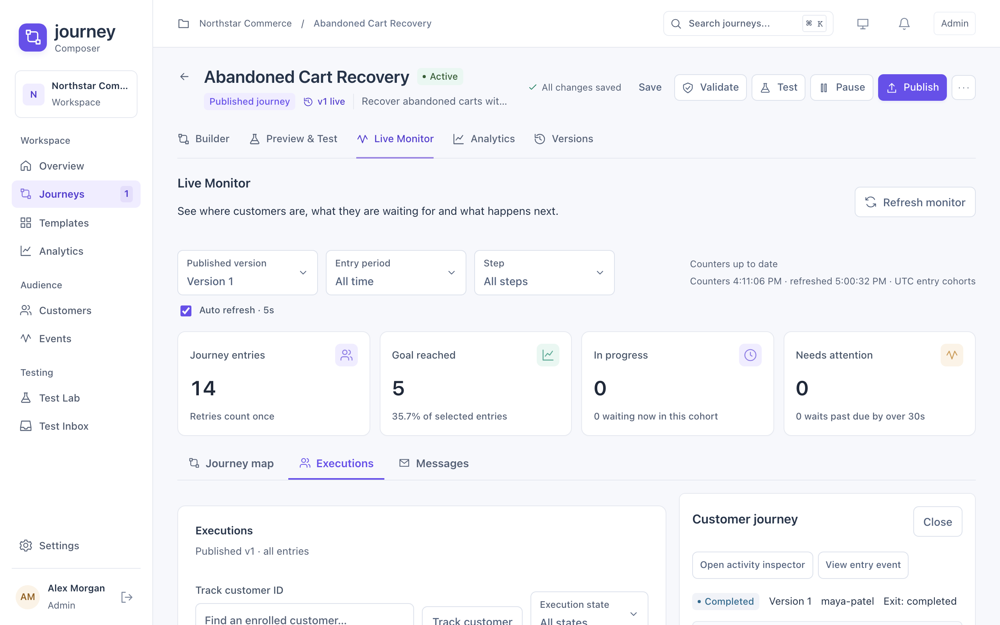

## Journey analytics and drilldowns

Published-version/cohort reporting, node outcomes and customer execution paths.

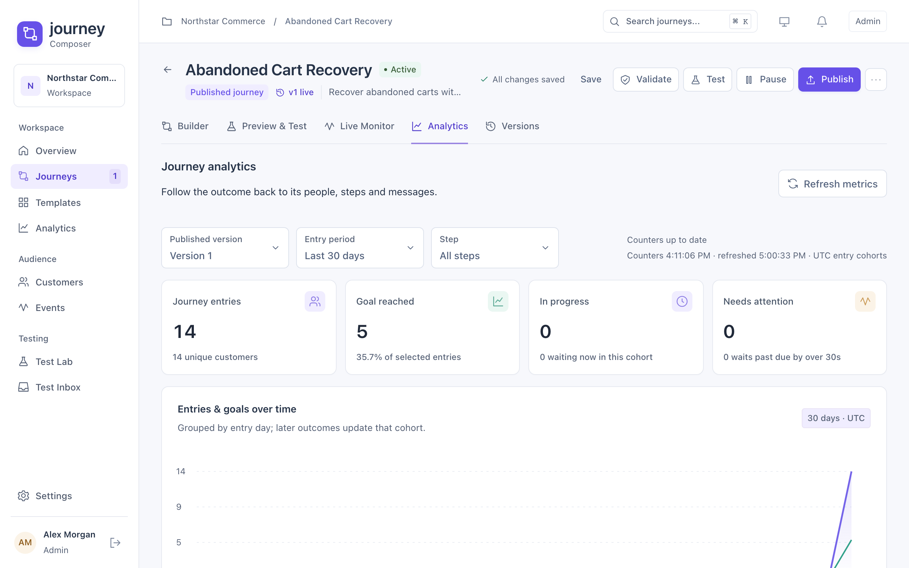

[Node breakdown](journey-observability/node-breakdown.png) ·
[Customer path](journey-observability/customer-path.png) ·
[Observation capture details](journey-observability/README.md).

## Workspace analytics

Entries, conversions and channel outcomes from the local execution engine. Activity appears on the days the seed actually ran. Reused fixtures retain their original timestamps.

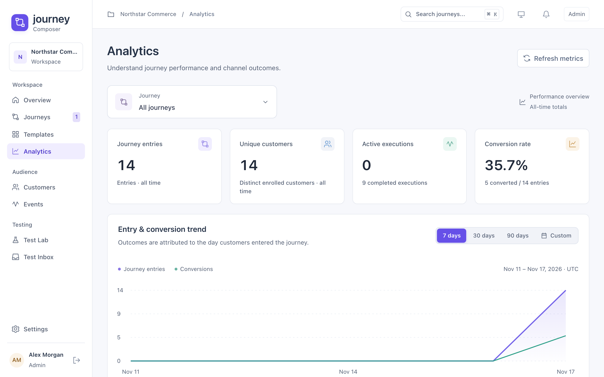

## Customers

Fictional profiles and their communication preferences.

## Publish review

Review and acknowledgement before activation. Capturing this screen does not publish the recovery draft.

