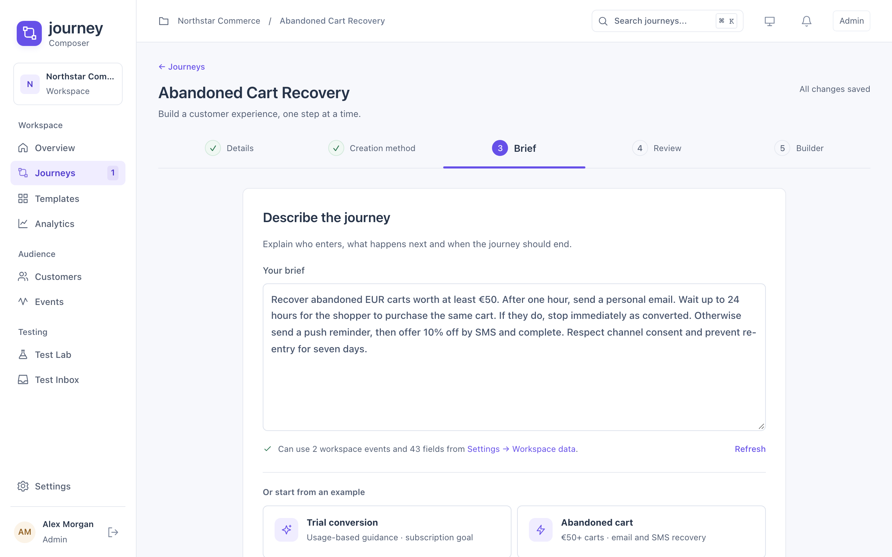
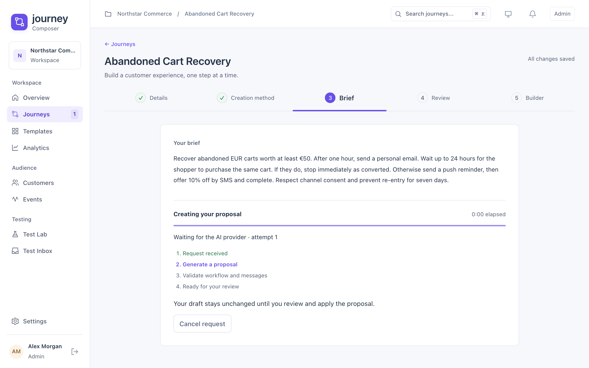
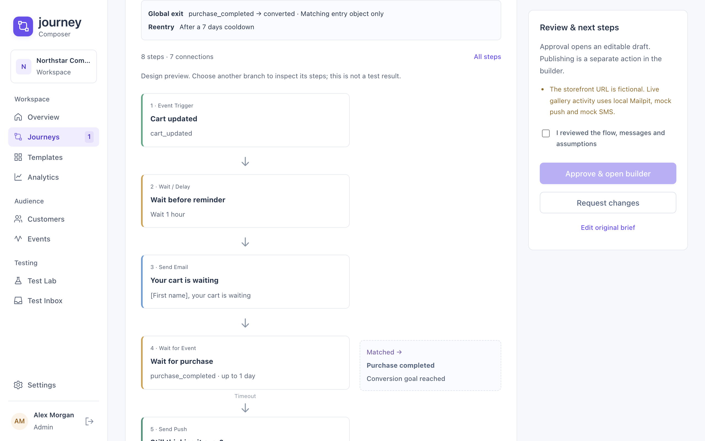
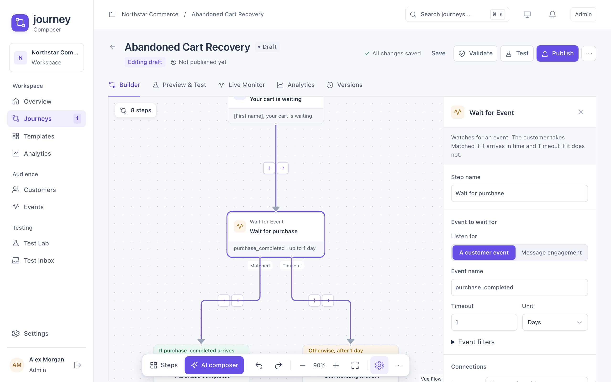

# Journey creation gallery

Refreshed November 17, 2026 from the running application at 1280 × 800 CSS pixels,
2× display scale (**2560 × 1600 PNGs**). Fictional isolated workspace.

These captures replay a recorded generation stream locally: the proposal is the
human-authored showcase recipe ([scripts/showcase-recipe.mjs](../../../scripts/showcase-recipe.mjs)),
so no provider is called and the pictures can be reproduced without a key. The
application still runs its normal validation, review and human approval on it. It
stays Draft; no messages were dispatched or journey published. No screenshot text,
metric or geometry was patched.

The earlier gallery of November 13 came from a real OpenAI `gpt-6-luna` generation
of the same brief (40.9 seconds, 11,320 tokens, one automatic repair).
[That capture's attempt history and caveats](../../reports/live-creation-capture-2026-11-13.md).

## Brief → generation → review → canvas

Write the brief and choose an example if useful:

Follow the processing stage without losing the submitted brief:

Review the proposed path and alternatives before approving:

Continue editing in the canvas:

## All captures

| Stage                | Capture                                                     |
| -------------------- | ----------------------------------------------------------- |
| Creation method      | [Scratch or AI](method.png)                                 |
| Brief and examples   | [Dedicated brief page](brief.png)                           |
| Scoped obligations   | [Business contract editor](contract.png)                    |
| Generation feedback  | [Pending provider and lifecycle steps](generating.png)      |
| Contract review      | [Independent expected outcomes and approval](review.png)    |
| Path review          | [Diagram and alternate branches](review-diagram.png)        |
| Editable graph       | [Builder at the start](canvas-start.png)                    |
| Contextual inspector | [Wait-for-event step and its connections](canvas-focus.png) |

[Capture manifest](manifest.json) · [Reproduction](../../SHOWCASE.md)
· [Shared recipe](../../../scripts/showcase-recipe.mjs).
