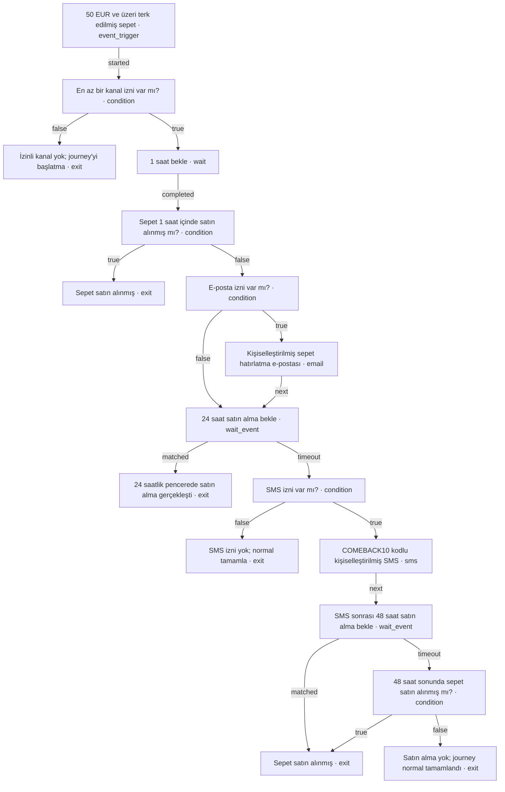

# Fresh paid Luna generation — 2026-11-12

Result: **PASS, 10/10** customer/event scenarios. This is a fresh live-generated
workflow, not the earlier recorded or manually corrected fixture. Repository
revision at start: `ced4657`. The unmodified application adapter used
`gpt-6-luna`, `composer.v2` and the selected `cart-recovery-eur.v1` contract.

## 1. Brief and initial state

Created a new isolated workspace and an empty Draft. No live customer/event
payload was attached to the model request. Exact [Composer request](composer-request.json)
and [effective initial system prompt](system-prompt.txt) are preserved without
headers, credentials or secrets.

Brief sent:

> 50 EUR ve üzeri sepet oluşturup satın almayan müşteriler için abandoned cart recovery journey'si oluştur. Giriş event'i cart_abandoned; amount >= 50 ve currency EUR şart. İki kanal izni de yoksa hiç beklemeden condition_not_met ile çık. İlk 1 saat sonunda mevcut sepet satın alınmış mı diye customer.attributes.cart_purchased alanını kontrol et; true ise converted ile çık, mesaj gönderme. Değilse yalnızca email izni varsa kişiselleştirilmiş email gönder. Email izni yok fakat SMS izni varsa email'i atla ve yine 24 saatlik satın alma penceresini koru. Email adımından sonraki 24 saat içinde purchase_completed gelirse converted ile çık. Satın alma yok ve SMS izni varsa COMEBACK10 koduyla %10 indirim SMS'i gönder; SMS izni yoksa normal completed ile tamamla. SMS'ten sonra 48 saat daha satın alma bekle; sürenin sonunda mevcut sepetin cart_purchased profil alanını yeniden kontrol et: true ise converted, değilse completed. purchase_completed her aktif aşamada derhal converted global exit yapsın. Aynı müşteri bu journey'ye son girişten itibaren 7 gün içinde yeniden giremesin; aynı execution içindeki email ve SMS bu re-entry kuralıyla engellenmesin. Workspace frequency cap ve kanal izinlerini runtime uygular. Tüm mesajlarda müşterinin adı ve sepet tutarı dinamik olsun. İsim: customer.attributes.first_name; tutar: event.properties.amount_display; numeric eşik: event.properties.amount. İzinler customer.consents.email ve customer.consents.sms. Kullanılabilir event'ler yalnızca cart_abandoned ve purchase_completed. URL https://example.com/cart demo adresidir; yayından önce gerçek adres ve kuponun doğrulanması gerektiğini uyar. İnsan açıklamalarını node label'larına yaz; exit.reason için yalnızca desteklenen kodları kullan. Journey'yi yayınlama.

An earlier UI preparation attempt failed on an exact-label selector before
Compose was clicked: zero provider calls, 31.071s.
The harness selector was corrected; application behavior was not changed.

## 2. Model generation and automatic repair

One Compose action caused **two real provider requests** under the application's
bounded repair policy. Both returned HTTP 200; the first candidate did not pass
application validation. The second passed. No additional manual regeneration
was requested.

| Provider attempt | Seconds | Input tokens | Output tokens | Reasoning, included in output | Result                               |
| ---------------- | ------: | -----------: | ------------: | ----------------------------: | ------------------------------------ |
| 1                |  34.704 |        2,102 |         4,614 |                         1,748 | Rejected; automatic repair requested |
| 2                |  12.382 |        4,992 |         2,043 |                           199 | Accepted                             |

Actual aggregate provider usage: **7,094 input +
6,657 output = 13,751 tokens**. Reasoning
1,947 is already included in output. Cached input
1,627 and cache-creation input
5,461 are reported input details, not additional
counters to add again. These are recorded usage values, not the previous smoke's
retrospective estimates.

The first rejected candidate's raw body and exact validation issues are not
retained by current generation telemetry. Its acceptance=false, timings and
usage are available; this report does not invent its rejection reason. The full
[final accepted proposal](proposal.json), including attempt/request identifiers,
is retained. Aggregate metadata was also written to the workspace audit log.

## 3. Review and Apply

Final output: **17 nodes, 18 edges**.
Before Apply the persisted draft still had zero nodes. Review confirmed:
EUR amount >=50, immediate no-channel exit, profile purchase checks after 1h and
the final wait, per-channel consent branches, the 24h/48h windows, global purchase
exit and the 604800-second re-entry cooldown. The five warnings concern the demo
cart URL, actual coupon validity, channel/provider configuration, current-cart
profile freshness and missing-value fallbacks.

[Actual review screenshot](02-review.png). The warnings were acknowledged and
Apply was clicked under the user's delegated test instruction. The persisted
graph exactly matches the accepted proposal; **zero manual graph/content edits**.
Subsequent API validation returned `valid=true`, `issues=[]`. Reload preserved
all nodes. [Actual canvas viewport after Apply](04-canvas.png); the Mermaid below
shows all branches even though the screenshot viewport clips the wide graph.

## 4. Persisted Test Lab scenarios

All messages below are sandbox outputs. Waiting periods were advanced by the
virtual clock, not shortened in the workflow.

| #   | Scenario                                           | Result | Simulated messages | Outcome           |
| --- | -------------------------------------------------- | ------ | -----------------: | ----------------- |
| 1   | A · Purchase after 30 minutes                      | PASS   |                  0 | converted         |
| 2   | B · Purchase after the email                       | PASS   |                  1 | converted         |
| 3   | C · Email and SMS, no purchase                     | PASS   |                  2 | completed         |
| 4   | D · SMS consent denied                             | PASS   |                  1 | completed         |
| 5   | E · Repeat enrollment inside seven days            | PASS   |                  0 | converted         |
| 6   | F · Below threshold: EUR 49.99                     | PASS   |                  0 | NOT_ENROLLED      |
| 7   | G · Exactly EUR 50 qualifies                       | PASS   |                  2 | completed         |
| 8   | H · Neither channel consent: immediate exit        | PASS   |                  0 | condition_not_met |
| 9   | I · Cart already purchased in profile              | PASS   |                  0 | converted         |
| 10  | J · Profile purchase update at +72h, without event | PASS   |                  2 | converted         |

The complete assertions, virtual elapsed times, personalized message data and
eligibility decisions are in [the chronological result](result.json).

## 5. Actual message outputs

Email subject:

> Alex, sepetiniz sizi bekliyor

Rendered email text:

> Merhaba Alex, 89.90 tutarındaki sepetiniz sizi bekliyor. Alışverişinize devam etmek için https://example.com/cart adresinden sepetinize dönün.

Rendered SMS:

> Merhaba Alex, 89.90 tutarındaki sepetinizi tamamlayın ve COMEBACK10 koduyla %10 indirim kazanın: https://example.com/cart

SMS metadata: Unicode, 121 units, 2 segments.
Recipient values are fictional sandbox examples, not real recipients. HTML was
sanitized before preview; consent and frequency checks are recorded as eligible.

## 6. Time and final state

| Measurement                                                                            | Seconds |
| -------------------------------------------------------------------------------------- | ------: |
| Provider attempts summed                                                               |  47.086 |
| Compose HTTP action, including validation/audit overhead                               |  47.169 |
| Agent review pause                                                                     |  66.262 |
| Apply + validation + ten tests + final capture                                         |   2.440 |
| Successful measured UI run, including setup and review                                 | 117.374 |
| Full measured session, including earlier unpaid preparation and harness correction gap | 193.204 |

The full-session value starts at the first browser harness attempt and excludes
preceding container/script preparation. It is not model inference latency.

Final publication check: `ready=true`, `issues=[]`. **Publish was not called.**
The journey remains Draft, with zero versions, live customers/executions and
real delivery jobs. The temporary backend carrying the key was removed. Existing
application AI settings were unchanged. This validates one fresh generation and
its bounded repair, not every possible future prompt or provider response.
