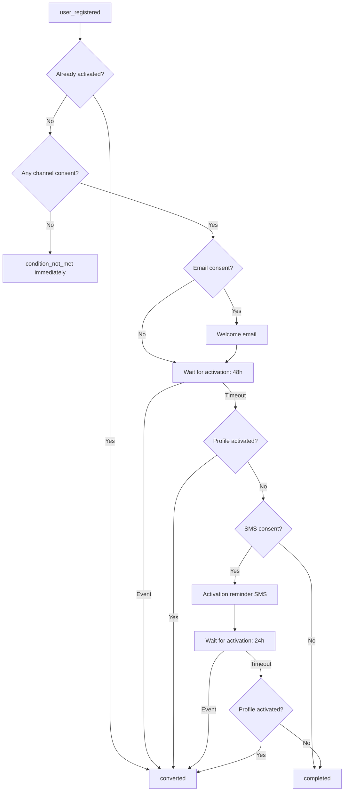

# Live Luna onboarding trial — 2026-11-12

One explicitly user-authorized paid Composer action, using `gpt-6-luna`,
`composer.v2` and General workflow mode. This tests a new SaaS onboarding brief,
not the EUR cart-recovery contract. No manually corrected fixture was used.

## Sequence and outputs

1. Registered a fictional isolated workspace and created an empty Draft.
2. Submitted [the exact brief and Composer request](composer-request.json) through
   the real browser UI to a temporary local API configured for Luna. Existing
   application AI settings were unchanged. One provider attempt succeeded;
   no automatic repair or additional generation was needed.
3. Reviewed [the complete proposal](proposal.json): 19 nodes, 19 edges, entry
   `user_registered`, global exit `account_activated`, once-only reentry. Before
   Apply the persisted draft still contained zero nodes. The review warnings
   explicitly say graph validity does not prove brief compliance, the activation
   URL is a placeholder, provider configuration is required and missing names
   use fallbacks. [Review screenshot](02-review.png).
4. Applied the exact proposal without graph edits; persisted workflow equality
   and API validation passed with no issues. [Canvas screenshot](04-canvas.png)
   is a viewport capture; use the JSON for the entire wide graph.
5. Ran [ten explicit sandbox scenarios](scenarios.json), checking message counts,
   exit reasons, virtual end time and absence of duplicate logical deliveries.
   All passed. Rendered messages and each assertion are in [result.json](result.json).
6. Verified Draft status, no versions, no live customers, no production
   executions and no delivery jobs in the isolated workspace. All Inbox records
   are SIMULATED. Read-only publish readiness returned true; Publish and Send Test
   were never called. Removed the temporary API container after the run.

## Generated flow

Global `account_activated` exits every active stage as converted. Reentry is
`once`. The JSON preserves the actual separate exit nodes; this diagram merges
identical outcomes for readability.

## Scenario results

| Scenario                                 | Email / SMS | Outcome                   | Virtual end | Result |
| ---------------------------------------- | ----------- | ------------------------- | ----------- | ------ |
| Already activated at entry               | 0 / 0       | converted                 | 0           | PASS   |
| Activation event at +30m                 | 1 / 0       | converted                 | 30m         | PASS   |
| Activation after SMS at +60h             | 1 / 1       | converted                 | 60h         | PASS   |
| No activation                            | 1 / 1       | completed                 | 72h         | PASS   |
| No SMS consent                           | 1 / 0       | completed                 | 48h         | PASS   |
| SMS consent only                         | 0 / 1       | completed                 | 72h         | PASS   |
| No channel consent                       | 0 / 0       | condition_not_met         | 0           | PASS   |
| Profile activation at +47h, no event     | 1 / 0       | converted                 | 48h         | PASS   |
| Profile activation at +71h, no event     | 1 / 1       | converted                 | 72h         | PASS   |
| Re-registration at +80h after completion | 1 / 1       | completed, one enrollment | 80h         | PASS   |

The last scenario ends its virtual clock at the later input event; the journey
completed at 72h and the 80h registration creates no new enrollment.

## Actual rendered messages

Email subject: `Hoş geldiniz, Alex`

> Merhaba Alex,
>
> Atlas hesabınızı etkinleştirmeye başlayın: https://example.com/activate

SMS:

> Merhaba Alex, Atlas hesabınızı etkinleştirmek için: https://example.com/activate

Both name and product resolve from profile attributes. No missing attributes
were reported for these inputs. SMS is Unicode, 80 units / 2 segments. Email
HTML sanitization adds `rel="nofollow"`; the Inbox records that warning.

## Measured latency and usage

| Measurement                                                  | Actual    |
| ------------------------------------------------------------ | --------- |
| Provider attempts                                            | 1         |
| Provider HTTP request                                        | 38.140s   |
| Composer HTTP round trip                                     | 38.219s   |
| Review pause                                                 | 11.530s   |
| Apply, validation, tests, isolation and capture after review | 2.448s    |
| Full browser harness                                         | 53.763s   |
| Input tokens                                                 | 1,954     |
| Output tokens                                                | 4,141     |
| Total tokens                                                 | **6,095** |
| Reasoning tokens, already included in output                 | 1,160     |
| Cached input tokens                                          | 0         |
| Provider-reported cache creation detail                      | 1,951     |

The full harness includes workspace/UI setup and agent review, not just model
inference. Preparation, evidence writing and cleanup are outside this timing.
Reasoning and cache details are subsets, not additional tokens. Usage is the
actual provider response metadata; no currency cost is inferred.

## Scope and limits

This is one live output tested with ten sandbox cases, not evidence that all
future onboarding generations are correct. No onboarding-specific automatic
behavior contract exists; these scenarios provide reviewed acceptance evidence.
No real provider delivery, crash/race load test, benchmark or deployment was
performed in this slice. Application code and runtime behavior were unchanged.

Validation for this evidence slice: repository formatting, `git diff --check`
and Gitleaks directory scan. Product code suites were not rerun for a
report-only change; the live browser/API checks above actually executed.
